# Form 1040 line 10 — flowchart (as the code does it)

IRS rules: `C:\us-tax\new_lines\10.md`. Code details and deviations: `C:\us-tax\new_knowledge\10.md`.

Before the adjustments are summed, `prepare` injects Form 8889 line 13 (HSA) and Form 8853 line 5 (Archer MSA) into
the two Income adjustments forms, removes line 12 amounts that fail the eligibility tests, adds W-2 code P for Form
3903, and computes Schedule SE and the self-employed deductions. `computeIncomeAdjustments` then builds lines 11–24z
(spouse form dropped on MFS), reading 1099-INT / 1099-OID penalties and Form 1098-E interest for the **whole
household** (D-10-1, D-10-2, D-10-3), and sums line 26 — with the unprorated half-SE tax (D-10-4). After AGI is known,
the typed IRA deduction is phased out and checked against compensation, and second passes apply the student-loan
phase-out, the Olympic ceiling and the performing-artist test. Line 26 becomes Form 1040 line 10 and AGI = line 9 −
line 10.

Main code: `computeIncomeAdjustments` (`TaxReturnComputeService.java:32742`), IRA block (`:4483-4770`), second passes
(`:7252-7315`, `:7533`), `buildAdjustments` (`:18833`).

```mermaid
flowchart TD
    S([Compute return]) --> FORMS[/"Income adjustments forms<br/>taxpayer + spouse"/]:::input
    F8889[[Form 8889 line 13]] --> INJ["Inject HSA (overwrites typed) and MSA (only if blank - D-10-10)"]
    F8853[[Form 8853 line 5]] --> INJ
    FORMS --> INJ
    INJ --> L12E{"Line 12 group and tests pass?"}
    L12E -->|"answer missing"| L12F>SCHEDULE1_LINE12_ELIGIBILITY_ANSWER_REQUIRED blocks]:::flag
    L12E -->|fails| L12X["Remove line 12 amounts, advisory"]
    L12E -->|passes| MFS
    L12X --> MFS{"MFS return?"}
    MFS -->|yes| DROP["Spouse form set to null"]
    MFS -->|no| L11
    DROP --> L11["Line 11: each side capped at 300 - no eligibility check D-10-12"]:::warn
    L11 --> L12["Line 12: Form 2106 line 10, meals 50 or 80 percent"]
    L12 --> L13["Line 13: HSA, typed capped at 9,550"]
    L13 --> L14{"Active-duty move answered Yes?"}
    L14 -->|no| L14F>SCHEDULE1_LINE14_NOT_ACTIVE_DUTY blocks]:::flag
    L14 -->|yes| L14C["Line 14: costs minus W-2 code P; boxes never checked D-10-14"]:::warn
    L14C --> SE[[Schedule SE and self-employed deductions]]
    L14F --> SE
    SE --> L1517["Lines 15, 16, 17; no S-corp shareholder path D-10-9"]:::warn
    INTS[/"Every 1099-INT box 2 and 1099-OID penalty in the account"/]:::input --> L18["Line 18: larger of typed and statements; no person filter D-10-1"]:::warn
    L1517 --> L18
    L18 --> L19{"Alimony agreement after 2018?"}
    L19 -->|yes| L19F>SCHEDULE1_LINE19A_POST2018 blocks]:::flag
    L19 -->|no| L19A["Line 19a, 19b, 19c from the larger payer"]
    L19A --> L20["Line 20 = typed IRA deduction, not checked against contributions D-10-6"]:::warn
    E1098[/"Every Form 1098-E in the account"/]:::input --> L21["Line 21 = typed plus 1098-E total D-10-3, D-10-2"]:::warn
    L20 --> L21
    L21 --> L21Q{"MFS or claimed as a dependent?"}
    L21Q -->|yes| L21F>SCHEDULE1_LINE21 MFS or DEPENDENT blocks, not overrideable]:::flag
    L21Q -->|no| L21C["Cap 2,500"]
    L21C --> L23["Line 23 Archer MSA, advisory"]
    L21F --> L23
    L23 --> L24["Lines 24a-24k typed; 24b capped at 8l; 24h and 24i capped or blocked; 24c and 24a not capped D-10-13"]:::warn
    K1[/"K-1 Form 1041 box 11 code A"/]:::input -.-> K1X["Never read D-10-5"]:::oos
    F2555P9["Form 2555 Part IX housing deduction - typed only D-10-16"]:::oos
    L24 --> L24Z["Line 24z: any write-in D-10-11"]:::warn
    L24Z --> L25["Line 25 = 24a to 24z"]
    L25 --> L26["Line 26 = 11 to 23 + 25, line 15 unprorated D-10-4"]:::warn
    L26 --> AGI["Form 1040 line 10, line 11a = line 9 - line 10"]
    AGI --> IRAQ{"IRA claimed and someone covered?"}
    IRAQ -->|yes| IRAP["Pub. 590-A phase-out, MAGI misses 24j add-back D-10-7; with SS benefits iterate D-6b-2"]:::warn
    IRAP --> IRAC{"Over dollar limit or compensation?"}
    IRAQ -->|no| IRAC
    IRAC -->|yes| IRAF>IRA_DEDUCTION_EXCEEDS_COMPENSATION blocks, overrideable - compensation D-10-8, D-1b-6, D-1g-2, D-1z-1]:::flag
    IRAC -->|no| PASS2
    IRAF --> PASS2{"Second pass needed?"}
    PASS2 -->|"student loan MAGI over 85k or 170k"| P2A["Re-run with phased-out line 21"]
    PASS2 -->|"AGI plus 24c over 1M"| P2B["Re-run with line 24c = 0"]
    PASS2 -->|"performing artist AGI over 16k"| P2C["Re-run without line 12 artist amount"]
    PASS2 -->|no| OUT["form1040.adjustments.adjustmentsSchedule1<br/>schedule1.adjustments.totalAdjustmentsToIncome"]:::output
    P2A --> OUT
    P2B --> OUT
    P2C --> OUT
    OUT --> NEXT[["Form 1040 line 11a and 11b, Social Security worksheet subset 11-20, 23, 25"]]:::output
    UI["Form still says lines 15-17 not supported D-10-15"]:::warn

    classDef input fill:#e3f2fd,stroke:#1565c0
    classDef flag fill:#ffebee,stroke:#c62828
    classDef output fill:#e8f5e9,stroke:#2e7d32
    classDef warn fill:#fff3e0,stroke:#e65100
    classDef oos fill:#f5f5f5,stroke:#9e9e9e,stroke-dasharray: 5 5
```

Deviation ids in the chart: D-10-1 (line 18 household penalties), D-10-2 (household 1098-E blocks MFS / dependent
returns), D-10-3 (typed + 1098-E added), D-10-4 (line 26 uses unprorated line 15), D-10-5 (K-1 1041 code A not read),
D-10-6 (IRA deduction vs contributions), D-10-7 (IRA MAGI misses 24j), D-10-8 (IRA compensation: box 11, line 16),
D-10-9 (S-corporation line 17), D-10-10 (typed Archer MSA wins), D-10-11 (line 24z write-ins), D-10-12 (educator
eligibility), D-10-13 (24a / 24c not capped), D-10-14 (line 14 / 20 boxes), D-10-15 (stale "not supported" section),
D-10-16 (Form 2555 housing deduction typed). Related, recorded elsewhere: D-1b-6, D-1g-2, D-1z-1, D-6b-2.
