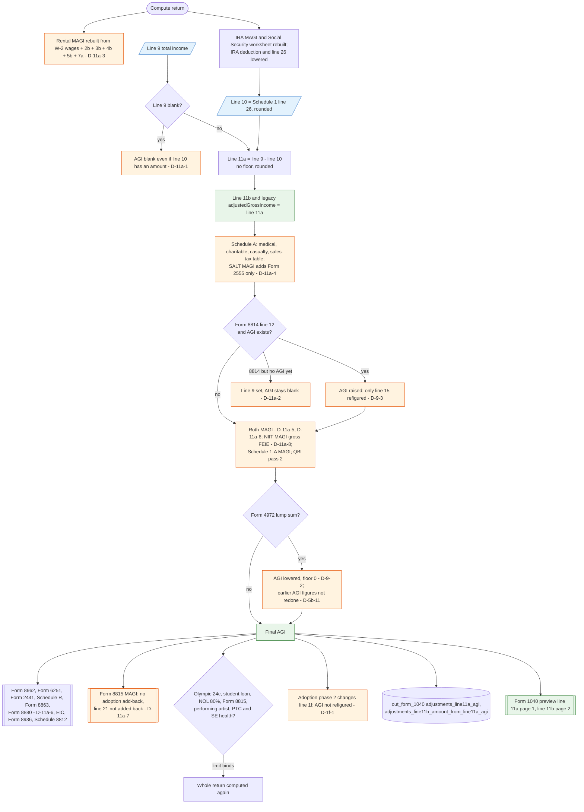

# Form 1040 line 11a / 11b — flowchart (as the code does it)

IRS rules: `C:\us-tax\new_lines\11a.md`. Code details and deviations: `C:\us-tax\new_knowledge\11a.md`.

`buildAdjustments` rounds line 10 (Schedule 1 line 26, already lowered by the IRA phase-out) and line 9, and sets
line 11a = line 9 − line 10 with no floor; line 11b and the legacy `adjustedGrossIncome` are the same value. If line 9
is blank, AGI is blank even when line 10 has an amount (D-11a-1). Figures built from AGI then run in pipeline order:
the Schedule A floors and the SALT MAGI first (missing Puerto Rico / Form 4563, D-11a-4), then the Form 8814 patch
raises AGI (D-9-3; not at all when no AGI exists yet, D-11a-2), then the Roth (D-11a-5, D-11a-6), NIIT (D-11a-8) and
Schedule 1-A MAGIs, then the Form 4972 patch lowers AGI with a floor at zero (D-9-2, D-5b-11), then the credits and
the re-run checks. The §469 rental MAGI never reads AGI at all (D-11a-3), and the Form 8815 MAGI misses two add-backs
(D-11a-7).

Main code: `buildAdjustments` (`TaxReturnComputeService.java:18833-18872`), patches at `:5122-5131` and `:6075-6085`.

Deviation ids in the chart: D-11a-1 (blank AGI with line 10), D-11a-2 (Form 8814 as the only income), D-11a-3 (§469
MAGI rebuilt), D-11a-4 (SALT MAGI add-backs), D-11a-5 (Roth MAGI qualified-plan rollover), D-11a-6 (other spouse's
Form 2555 on MFS), D-11a-7 (Form 8815 MAGI), D-11a-8 (NIIT gross FEIE), plus D-9-2, D-9-3, D-5b-11 and D-1f-1.
