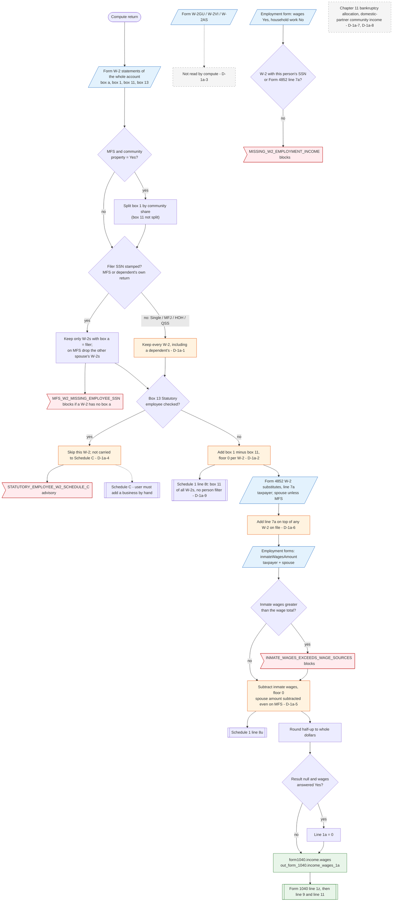

# Form 1040 line 1a — flowchart (as the code does it)

IRS rules: `C:\us-tax\new_lines\1a.md`. Code details and deviations: `C:\us-tax\new_knowledge\1a.md`.

The compute loads every Form W-2 stored in the account for 2025 (taxpayer's, spouse's and dependents'). Only on a
married-filing-separately or dependent's-own return is the list narrowed to the filer's W-2s (box a); on single,
joint and head-of-household returns every W-2 counts (D-1a-1). Each kept W-2 adds box 1 less box 11, unless box 13
"Statutory employee" is checked, in which case it is skipped with a Schedule C advisory (D-1a-4). Form 4852 W-2
substitutes (line 7a) are then added (D-1a-6: added even when they replace a W-2 still on file), the inmate wages
from the Employment forms are subtracted (D-1a-5: the spouse's too on MFS), the total is rounded, and the result
becomes `form1040.income.wages`, which feeds line 1z. Box 11 always goes to Schedule 1 line 8t (D-1a-2, D-1a-9).
Guam / Virgin Islands / American Samoa W-2s never enter (D-1a-3).

Main code: `computeLine1aWages` (`TaxReturnComputeService.java:40957`) and the line 1a block of `buildIncome`
(`TaxReturnComputeService.java:18256-18357`).

Deviation ids in the chart: D-1a-1 (dependent W-2 on the parent's return), D-1a-2 (box 11 always subtracted),
D-1a-3 (territory W-2s), D-1a-4 (statutory employee not handed to Schedule C), D-1a-5 (spouse inmate wages on MFS),
D-1a-6 (Form 4852 on top of an incorrect W-2), D-1a-7 (chapter 11), D-1a-8 (domestic partners), D-1a-9 (line 8t and
other copies of line 1a are not person-filtered).
