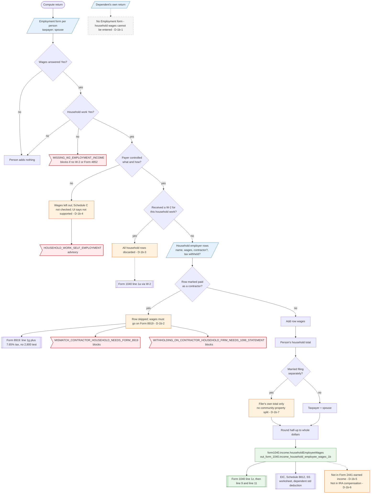

# Form 1040 line 1b — flowchart (as the code does it)

IRS rules: `C:\us-tax\new_lines\1b.md`. Code details and deviations: `C:\us-tax\new_knowledge\1b.md`.

Line 1b comes only from the Employment form (taxpayer and spouse); no statement feeds it. For each person the
compute checks four answers in order — wages Yes, household work Yes, the payer controlled the work Yes, and "received
a W-2 for this household work" No — then adds the wages of every household employer row not marked "paid as a
contractor". A control-test No only raises an advisory and the wages leave the return (D-1b-4); a W-2 Yes discards
every row (D-1b-3); a contractor row is pushed to Form 8919 and line 1g with social security and Medicare tax even
under the $2,800 test (D-1b-2). The spouse's amount is added unless the return is married filing separately, the sum
is rounded and becomes `form1040.income.householdEmployeeWages`, which feeds line 1z. Form 2441 earned income and IRA
compensation do not pick it up (D-1b-5, D-1b-6). A dependent's own return has no Employment form (D-1b-1), and
community-property separate returns do not split it (D-1b-7).

Main code: `householdEmployeeAmount` / `sumHouseholdEmployeeWages` (`TaxReturnComputeService.java:42334-42382`) and
the line 1b block of `buildIncome` (`TaxReturnComputeService.java:18308-18316`).

Deviation ids in the chart: D-1b-1 (no household wages on a dependent's own return), D-1b-2 (1099-paid household
wages forced to Form 8919 / line 1g with tax), D-1b-3 (one W-2 answer discards every row), D-1b-4 (control test No
drops the wages; stale UI text), D-1b-5 (Form 2441 earned income), D-1b-6 (IRA compensation), D-1b-7 (no
community-property split).
