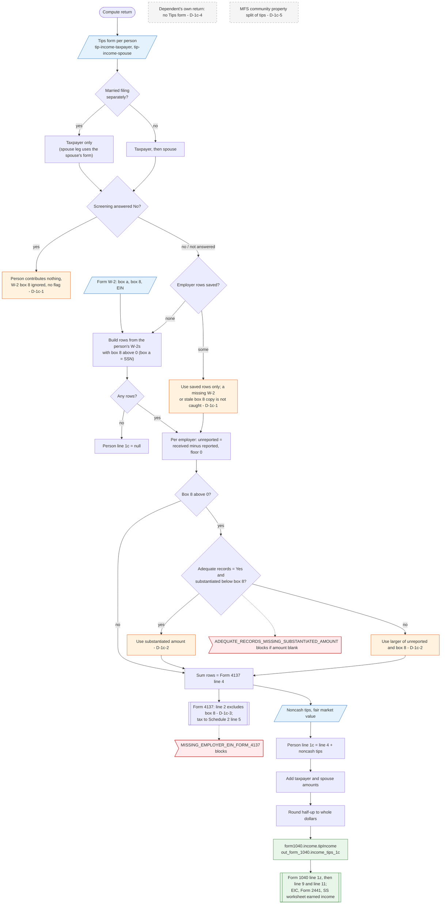

# Form 1040 line 1c — flowchart (as the code does it)

IRS rules: `C:\us-tax\new_lines\1c.md`. Code details and deviations: `C:\us-tax\new_knowledge\1c.md`.

The compute reads the Tips form of the taxpayer and, unless the return is married filing separately, of the
spouse. A person who answered "No" to the screening question contributes nothing, even with a W-2 box 8 on file
(D-1c-1). If the person's Tips form has no employer rows, rows are built from the person's W-2s (box a = their SSN)
that show box 8 allocated tips; a saved row list is never completed from the W-2s (D-1c-1). For each employer row
the unreported amount is tips received − tips reported, replaced by the substantiated amount (adequate records and
less than box 8) or by box 8 when box 8 is larger (D-1c-2). The sum is Form 4137 line 4 (whose printed line 2 leaves
box 8 out, D-1c-3); noncash tips are added, the spouse's total is added, the result is rounded and becomes
`form1040.income.tipIncome`, which feeds line 1z. A dependent's own return has no Tips form (D-1c-4) and a community
property split is never applied to tips (D-1c-5).

Main code: `computeTips` / `computeTipsForPerson` (`TaxReturnComputeService.java:42555`, `:42580`),
`buildTipEntriesFromW2` (`:52320`), rounding in `buildIncome` (`:18437`).

Deviation ids in the chart: D-1c-1 (W-2 box 8 dropped with "No", a partial row list or a stale copy), D-1c-2
(substantiated amount and received − reported not reconciled), D-1c-3 (printed Form 4137 line 2 leaves out box 8),
D-1c-4 (dependent's own return cannot enter tips), D-1c-5 (no community property split of tips on MFS).
