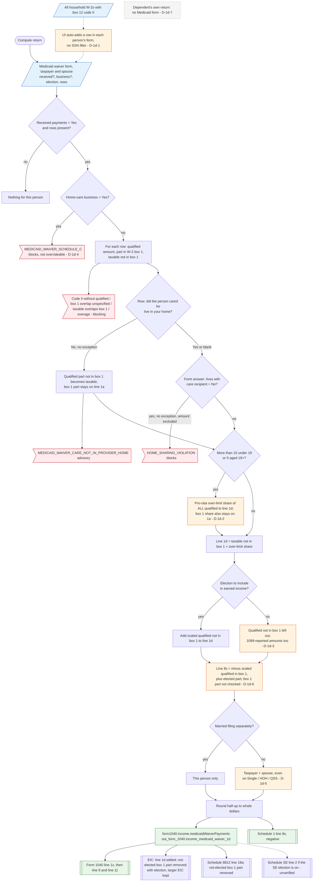

# Form 1040 line 1d — flowchart (as the code does it)

IRS rules: `C:\us-tax\new_lines\1d.md`. Code details and deviations: `C:\us-tax\new_knowledge\1d.md`.

Line 1d is built from each person's "Medicaid waiver payments" form, not from statements. When the form is opened,
the UI adds a row for every household W-2 with box 12 code II — the spouse's and dependents' too (D-1d-1). A
home-care business answer blocks the return (D-1d-4). Each payer row is split by the user into a qualified (Notice
2014-7) amount, the part of it inside W-2 box 1, and a taxable amount not in box 1; a row whose care recipient did not
live in the caregiver's home is taxed. Over the §131(c) head-count limit a pro-rata share becomes taxable on line 1d
— also for dollars already on line 1a (D-1d-2). Line 1d = taxable + over-limit share + (with the election) qualified
not in box 1; Schedule 1 line 8s backs out the box-1 qualified part always and the elected part (1099 payments only
when elected, D-1d-3; box-1 amount not checked against a W-2, D-1d-6). Taxpayer and spouse are added except on MFS
(D-1d-5), the total is rounded and feeds line 1z, the EIC and Schedule 8812.

Main code: `computeMedicaidWaiverPayments` (`TaxReturnComputeService.java:38371`) and `computeMedicaidForPerson`
(`TaxReturnComputeService.java:40556`).

Deviation ids in the chart: D-1d-1 (household code-II W-2s pre-filled into each person's form), D-1d-2 (over-limit
share of box-1 dollars taxed twice; limit per person, not per home), D-1d-3 (1099 payments off line 1d / 8s without
the election), D-1d-4 (home-care business blocked though Schedule C exists), D-1d-5 (spouse form added on non-joint
returns), D-1d-6 (box-1 back-out not checked against a W-2), D-1d-7 (no form on a dependent's own return).
