# Form 1040 line 1e — flowchart (as the code does it)

IRS rules: `C:\us-tax\new_lines\1e.md`. Code details and deviations: `C:\us-tax\new_knowledge\1e.md`.

On a joint return the taxpayer's and spouse's Child and dependent care forms are merged first; the spouse form's
own deemed-income and earned-income answers are dropped (D-1e-10). Compute then sums W-2 box 10 of the filer (and
spouse unless MFS), matching SSNs as text, so a dashes / no-dashes mismatch loses the benefits silently (D-1e-2).
Box 10 without a "Yes" to "Did you receive dependent care benefits?" blocks the return. Form 2441 Part III then
runs: line 12 less any part already in box 1, plus grace period, less forfeitures = line 15; line 16 is the typed
total or, when blank, out-of-pocket expenses plus line 15 (D-1e-1); earned income for lines 18 / 19 is W-2 box 1
plus tips, line 1g, line 1h and a typed extra, with gaps (D-1e-3, D-1e-4) and a deemed-income floor (D-1e-5,
D-1e-6); the $5,000 / $2,500 / plan limit gives line 21; line 25 is the smaller of lines 20 and 21 and line 26 =
line 15 − line 25. Line 26 becomes `form1040.income.dependentCareBenefits` and feeds line 1z.

Main code: `computeDependentCareBenefits` (`TaxReturnComputeService.java:38771-39263`) and `buildIncome`
(`TaxReturnComputeService.java:18439`).

```mermaid
flowchart TD
    S([Compute return]) --> FORMS[/"Child and dependent care forms<br/>taxpayer + spouse tab"/]:::input
    FORMS --> MERGE{"Joint return?"}
    MERGE -->|yes| MRG["Merge: amounts added; deemed income and extra earned income from taxpayer form only - D-1e-10"]:::warn
    MERGE -->|no| W2
    MRG --> W2[/"Form W-2: box a, box 1, box 10"/]:::input
    W2 --> SUM["Sum box 10 where box a = taxpayer SSN or spouse SSN unless MFS<br/>text match, not digits - D-1e-2"]:::warn
    SUM --> GATE{"Box 10 > 0 and benefits question not Yes?"}
    GATE -->|yes| GF>DEPENDENT_CARE_BENEFITS_FORM_REQUIRED blocks]:::flag
    GATE -->|no| ANY{"Box 10 or any form data?"}
    ANY -->|no| NUL["Line 1e = null"]
    ANY -->|yes| L12["Line 12 = box 10 - part already in box 1<br/>no self-employed or K-1 code O benefits - D-1e-7"]:::warn
    L12 --> L15["Line 15 = line 12 + line 13 grace period - line 14 forfeited, floor 0"]
    L15 --> L16Q{"Total care expenses typed?"}
    L16Q -->|yes| L16A["Line 16 = typed total"]
    L16Q -->|"no, care answered No"| L16C["Line 16 = 0"]
    L16Q -->|"no, otherwise"| L16B["Line 16 = per-person expenses + line 15 - D-1e-1"]:::warn
    L16A --> L17["Line 17 = min of line 15, line 16"]
    L16B --> L17
    L16C --> L17
    L17 --> EI[/"Earned income: W-2 box 1 by SSN less inmate wages<br/>+ tips 1c + 1g + earned 1h + typed extra"/]:::input
    EI --> EIX["Box 11 NQDC kept, Form 2555 exclusion not subtracted - D-1e-3<br/>no SE earnings, 1b, 1d, combat pay - D-1e-4"]:::warn
    EIX --> DEEM{"Student or disabled months?"}
    DEEM -->|yes| DEEMS["Floor = months x 250 or 500 on the annual figure - D-1e-6<br/>taxpayer floor on every filing status - D-1e-5"]:::warn
    DEEM -->|no| L19
    DEEMS --> SPLIT>DEPENDENT_CARE_BOTH_SPOUSES_DEEMED_INCOME_SPLIT advisory if over 12 months]:::flag
    DEEMS --> L19{"Filing status for line 19"}
    L19 -->|MFJ| L19J["Line 19 = spouse earned income"]
    L19 -->|"MFS, not considered unmarried"| L19M["Line 19 = typed spouse earned income, else line 18 - D-1e-8"]:::warn
    L19 -->|other| L19O["Line 19 = line 18"]
    L19M --> MFSF>DEPENDENT_CARE_MFS_SPOUSE_EARNED_INCOME_LIMIT advisory]:::flag
    L19J --> L20["Line 20 = min of lines 17, 18, 19"]
    L19M --> L20
    L19O --> L20
    L20 --> L21["Line 21 = 5,000 or 2,500 MFS without exception, capped at plan maximum"]
    L21 --> D129{"Plan failed 129(d) testing?"}
    D129 -->|yes| L25Z["Line 25 = 0, line 26 = line 15 (unverified rule)"]
    D129 -->|no| L25["Line 22 = 0, line 24 = 0<br/>Line 25 = min of lines 20, 21<br/>Line 26 = line 15 - line 25, floor 0"]
    L25 --> ZS>DEPENDENT_CARE_SPOUSE_EARNED_INCOME_ZERO advisory on MFJ]:::flag
    L25 --> RND["Round half-up to whole dollars<br/>0 is stored when only form data exists - D-1e-11"]:::warn
    L25Z --> RND
    RND --> OUT["form1040.income.dependentCareBenefits<br/>out_form_1040.income_dependent_care_benefits_1e<br/>Form 2441 line 26"]:::output
    OUT --> L1Z[["Form 1040 line 1z, then line 9 and line 11"]]:::output
    L25 --> P2[["Form 2441 lines 27-31: line 28 = 24 + 25 reduces the credit limit"]]
    PROV["Ineligible care provider check - D-1e-9"]:::oos

    classDef input fill:#e3f2fd,stroke:#1565c0
    classDef flag fill:#ffebee,stroke:#c62828
    classDef output fill:#e8f5e9,stroke:#2e7d32
    classDef warn fill:#fff3e0,stroke:#e65100
    classDef oos fill:#f5f5f5,stroke:#9e9e9e,stroke-dasharray: 5 5
```

Deviation ids in the chart: D-1e-1 (line 16 estimate includes the benefits), D-1e-2 (SSN text match),
D-1e-3 (NQDC and Form 2555 wages kept in earned income), D-1e-4 (self-employment and other earned income missing),
D-1e-5 (deemed income outside a joint return), D-1e-6 (deemed income annual, not monthly), D-1e-7 (self-employed /
partner benefits), D-1e-8 (MFS spouse earned income fallback), D-1e-9 (provider eligibility), D-1e-10 (spouse-tab
answers dropped on a joint return), D-1e-11 (line 1e = 0 without benefits).
