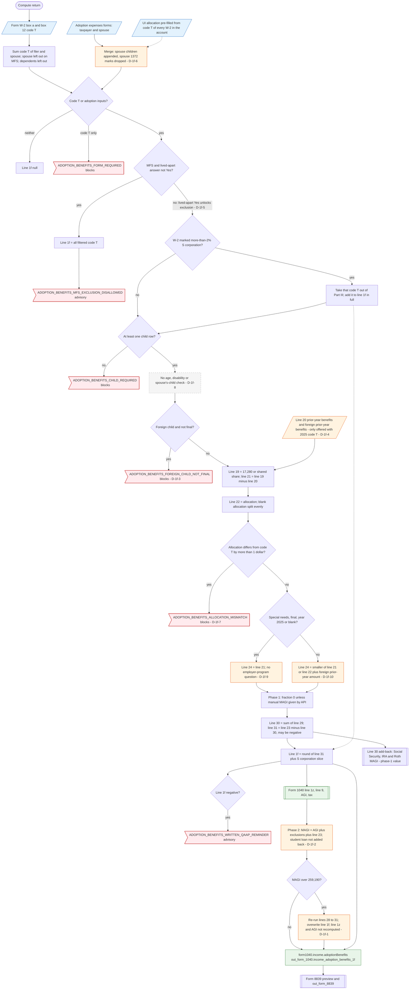

# Form 1040 line 1f — flowchart (as the code does it)

IRS rules: `C:\us-tax\new_lines\1f.md`. Code details and deviations: `C:\us-tax\new_knowledge\1f.md`.

The compute sums W-2 box 12 code T of the filer (and of the spouse unless the return is married filing separately);
a dependent's W-2 is not counted. On a joint return the two "Adoption expenses" forms are merged by appending the
spouse's children (D-1f-6). With code T but no adoption form the return blocks. Married filing separately without the
lived-apart answer puts all code T on line 1f (the other MFS tests are not asked, D-1f-5). Code T from a W-2 marked as a
more-than-2% S corporation is taxed in full. Each child then runs Form 8839 lines 19–24 (foreign child not final
blocks, D-1f-3; no eligible-child check, D-1f-8; special-needs rule without a QAAP question, D-1f-9; foreign prior-year
benefits, D-1f-10). Phase 1 uses a phase-out fraction of 0 because the UI never supplies MAGI; line 31 goes to line 1f
and line 1z. After AGI and the tax are figured, phase 2 derives MAGI (D-1f-2), re-runs the phase-out and overwrites
line 1f without recomputing line 1z or AGI (D-1f-1). Prior-year and foreign prior-year inputs exist only when the
account has 2025 code T (D-1f-4); the UI pre-fills the allocation from every W-2 in the account (D-1f-7).

Main code: `computeAdoptionBenefits` (`TaxReturnComputeService.java:39265`), `applyAdoptionCredit`
(`TaxReturnComputeService.java:44154`), `buildIncome` (`TaxReturnComputeService.java:18440`, `:18487`).

Deviation ids in the chart: D-1f-1 (phase-2 line 1f not carried into line 1z / AGI), D-1f-2 (line 25 MAGI formula),
D-1f-3 (foreign child not final blocks instead of taxing), D-1f-4 (prior-year inputs hidden without 2025 code T),
D-1f-5 (MFS exception tests incomplete), D-1f-6 (joint-return merge of the two forms), D-1f-7 (UI pre-fill from every
W-2 in the account), D-1f-8 (eligible-child test), D-1f-9 (special-needs rule without the employer-program test),
D-1f-10 (foreign prior-year worksheet).
