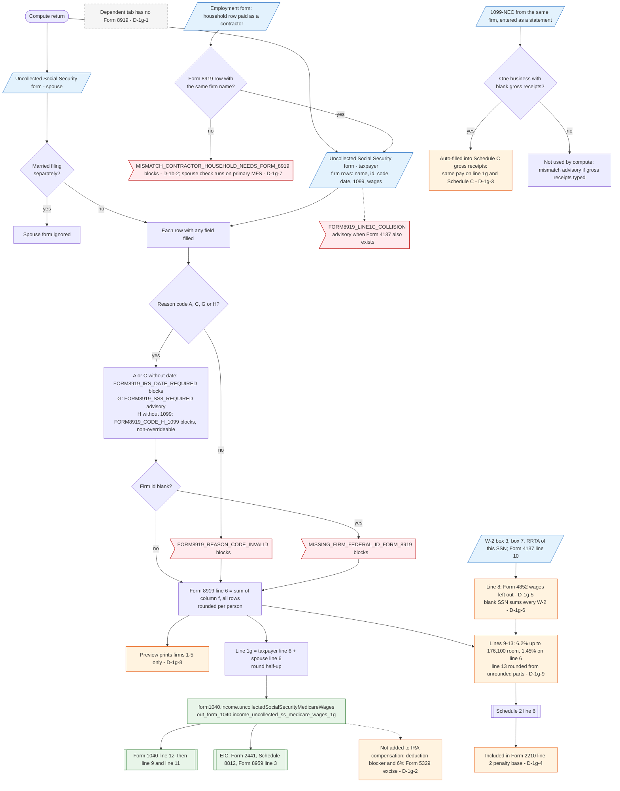

# Form 1040 line 1g — flowchart (as the code does it)

IRS rules: `C:\us-tax\new_lines\1g.md`. Code details and deviations: `C:\us-tax\new_knowledge\1g.md`.

Line 1g comes only from the "Uncollected Social Security" forms (the Form 8919 intake) of the taxpayer and the spouse;
no statement feeds it and a dependent has no such form (D-1g-1). For each person, every firm row with any field filled
is checked (reason code A / C / G / H, IRS date for A or C, a 1099 for H, a firm id) and its column (f) wages are added
into Form 8919 line 6. The spouse's form is skipped on a married-filing-separately return. Line 1g is the sum of the
two line 6 amounts, rounded, stored as `form1040.income.uncollectedSocialSecurityMedicareWages`, and fed to line 1z,
the EIC, Form 2441 and Form 8959 line 3 — but not to IRA compensation (D-1g-2). Lines 7–13 figure the tax for
Schedule 2 line 6 (line 8 misses Form 4852 wages, D-1g-5, and is unfiltered with a blank SSN, D-1g-6), which then
also lands in the Form 2210 penalty base (D-1g-4). A 1099-NEC from the same firm can be auto-filled into Schedule C
(D-1g-3). Household rows marked "paid as a contractor" are forced in here by a blocker (D-1b-2; on a primary MFS
return the spouse's check still runs, D-1g-7).

Main code: `computeUncollectedSSTax` / `computeForm8919ForPerson` (`TaxReturnComputeService.java:40348-40554`) and
`buildIncome` (`TaxReturnComputeService.java:18441`, `:18596-18597`).

Deviation ids in the chart: D-1g-1 (no Form 8919 for a dependent), D-1g-2 (Form 8919 wages not IRA compensation),
D-1g-3 (1099-NEC auto-filled into Schedule C), D-1g-4 (Form 8919 tax in the Form 2210 base), D-1g-5 (Form 4852 wages
not on line 8), D-1g-6 (blank SSN: unfiltered line 8), D-1g-7 (spouse household check blocks a primary MFS return),
D-1g-8 (only five firms printed), D-1g-9 (printed lines may not foot). D-1b-2 belongs to line 1b.
