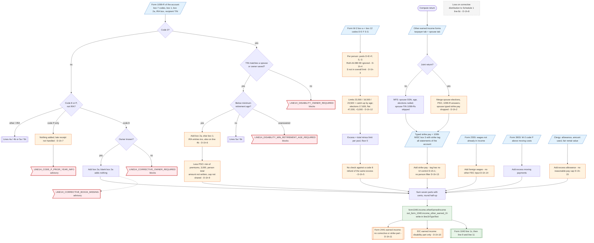

# Form 1040 line 1h — flowchart (as the code does it)

IRS rules: `C:\us-tax\new_lines\1h.md`. Code details and deviations: `C:\us-tax\new_knowledge\1h.md`.

On a joint return the spouse tab's Other earned income form is merged into the taxpayer's, but the spouse's typed
strike pay is dropped (D-1h-2). Compute then adds seven parts. Strike pay = the typed amount plus 1099-MISC box 3
tagged as strike pay — a tag no UI control can set (D-1h-1). Excess deferrals are figured per person from W-2 box 12
in three separate pools (D/E/F, S, G) with age catch-ups; Roth codes and the SIMPLE-into-overall rule are ignored
(D-1h-3, D-1h-4, D-1h-12) and a code-8 refund of the same excess is added again (D-1h-5). Every code-3 Form 1099-R,
IRA or not, is asked "below minimum retirement age?" (D-1h-6); Yes adds box 2a less a PSO exclusion. Non-IRA code 8
adds box 2a; code P adds nothing (D-1h-7). Form 2555 no-W-2 foreign wages, Form 3903 excess moving payments and a
minister's excess housing allowance complete the sum. The total is rounded and becomes
`form1040.income.otherEarnedIncome`, which feeds line 1z; only its disability part reaches the EIC (D-1h-10).

Main code: `computeOtherEarnedIncome` (`TaxReturnComputeService.java:39946-40263`), `mergeOtherEarnedForms`
(`:38730`), `computeExcessDeferralsForPerson` (`:41922`).

Deviation ids in the chart: D-1h-1 (strike tag cannot be set), D-1h-2 (spouse strike pay dropped on MFJ), D-1h-3
(SIMPLE not in the overall limit), D-1h-4 (Roth ignored in the limit), D-1h-5 (excess counted twice with a code-8
refund), D-1h-6 (IRA code 3 on line 1h and line 4b), D-1h-7 (late code P), D-1h-8 (corrective loss), D-1h-9 (PSO
amount and shared cap), D-1h-10 (EIC), D-1h-11 (Form 2441), D-1h-12 (457 / 403(b) / 501(c)(18) limits), D-1h-13
(household statements not person-filtered), D-1h-14 (foreign-employer pay), D-1h-15 (clergy reasonable pay).
