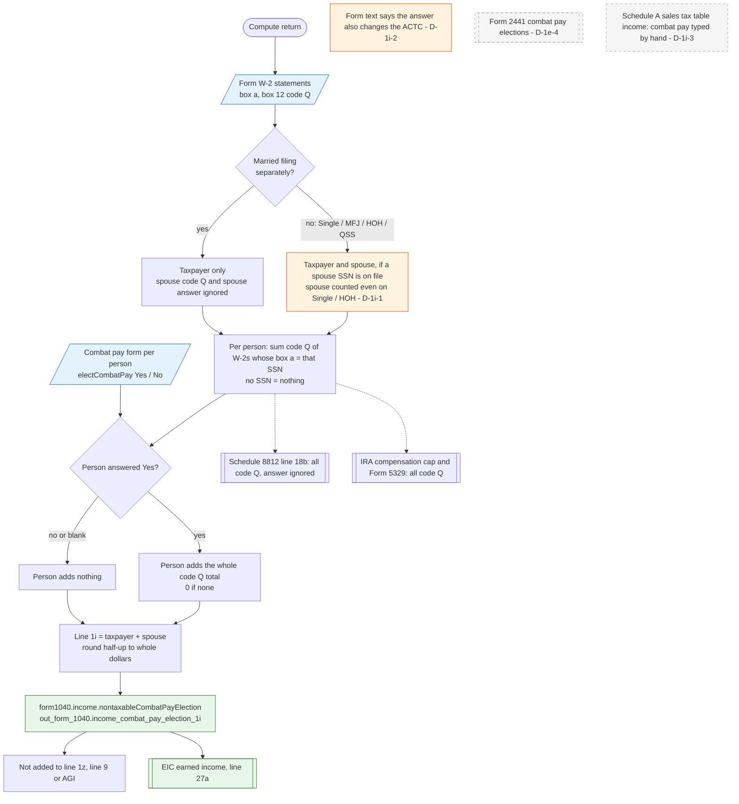

# Form 1040 line 1i — flowchart (as the code does it)

IRS rules: `C:\us-tax\new_lines\1i.md`. Code details and deviations: `C:\us-tax\new_knowledge\1i.md`.

For each person the compute adds the W-2 box 12 code Q amounts of the W-2s whose box a is that person's SSN. The
spouse is left out only on a married-filing-separately return, so on a single or head-of-household return a spouse
on file still counts (D-1i-1). A person who answered Yes on the Combat pay form puts their whole code Q total on line
1i (0 if none); No or no answer puts nothing. Line 1i is rounded, stored as
`form1040.income.nontaxableCombatPayElection`, kept out of line 1z, and added to EIC earned income. Schedule 8812 line
18b and IRA compensation read code Q directly, ignoring the election. Form 2441 never sees combat pay (D-1e-4), the
sales-tax table needs it typed by hand (D-1i-3), and the form's text says the answer also changes the ACTC (D-1i-2).

Main code: `computeCombatPay` (`TaxReturnComputeService.java:40265-40346`).

Deviation ids in the chart: D-1i-1 (spouse counted on a single / head-of-household return), D-1i-2 (form text says the
ACTC depends on the answer), D-1i-3 (sales tax table income). D-1e-4 (no Form 2441 combat-pay election) is recorded
under line 1e.
