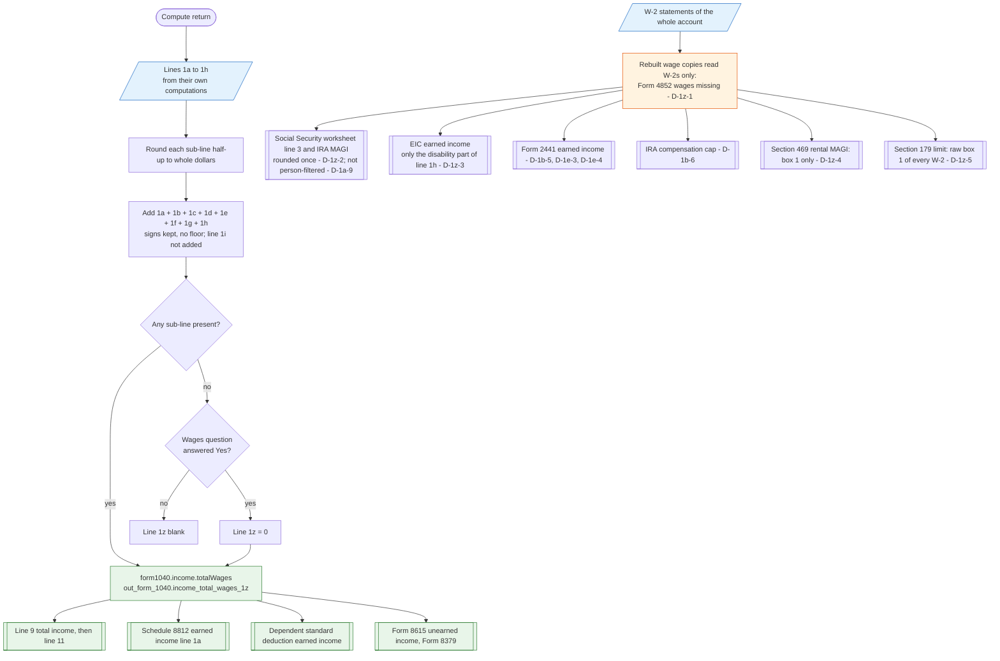

# Form 1040 line 1z — flowchart (as the code does it)

IRS rules: `C:\us-tax\new_lines\1z.md`. Code details and deviations: `C:\us-tax\new_knowledge\1z.md`.

`buildIncome` rounds each of lines 1a–1h to whole dollars, adds them with their signs (a negative line 1f lowers the
total), leaves line 1i out, and stores the result as `form1040.income.totalWages` — 0 when no sub-line exists but
"Did you receive any wages" was answered Yes, otherwise blank. Line 9, Schedule 8812, the dependent's standard
deduction, Form 8615 and Form 8379 read this real line 1z. Several other places rebuild their own wage figure from the
W-2 list instead, and those copies leave out Form 4852 wages (D-1z-1), round differently (D-1z-2), drop most of line
1h for the EIC (D-1z-3), or use raw W-2 wages for the §469 and §179 limits (D-1z-4, D-1z-5).

Main code: `buildIncome` (`TaxReturnComputeService.java:18435-18488`, stored `:18626-18630`).

Deviation ids in the chart: D-1z-1 (Form 4852 wages missing from every rebuilt copy), D-1z-2 (rebuilt copies round
once), D-1z-3 (EIC drops most of line 1h), D-1z-4 (§469 modified AGI), D-1z-5 (§179 limit). Recorded on other lines:
D-1a-9 (copies not filtered by person), D-1b-5 and D-1b-6 (line 1b missing from Form 2441 and IRA compensation),
D-1e-3 and D-1e-4 (Form 2441 earned income).
