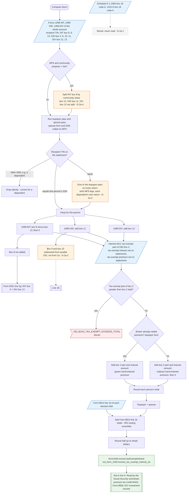

# Form 1040 line 2a — flowchart (as the code does it)

IRS rules: `C:\us-tax\new_lines\2a.md`. Code details and deviations: `C:\us-tax\new_knowledge\2a.md`.

The compute loads every Form 1099-INT, 1099-OID and 1099-DIV of the account for 2025 and runs a taxpayer pass and a
spouse pass. Each statement is kept by its recipient TIN: the taxpayer's SSN for the taxpayer pass, the spouse's SSN
for the spouse pass (nulled on MFS). A dependent's statement matches neither and is dropped; a statement with a blank
TIN is given to the taxpayer pass on every return (D-2a-3). Each kept statement adds 1099-INT box 8 less box 13
(box 9 goes only to Form 6251 line 2g), 1099-OID box 11 (its box 6 / box 10 premium is taken from the taxable OID
instead, D-2a-2) and 1099-DIV box 12. The user's tax-exempt part of 1099-OID box 2 and hand-entered tax-exempt
interest are added, the hand-entered tax-exempt premium subtracted. At return level the two persons and the Form 8814
line 1b totals are added and the result is rounded. Schedule K-1 tax-exempt interest is never read (D-2a-1).

Main code: `computeInterestForPerson` (`TaxReturnComputeService.java:19162`) and `computeInterestIncome`
(`TaxReturnComputeService.java:18875`).

Deviation ids in the chart: D-2a-1 (K-1 tax-exempt interest not read), D-2a-2 (tax-exempt OID premium taken from
the taxable side), D-2a-3 (blank-TIN statement on every return — same root cause as D-1a-1), D-2a-4 (community
property split incomplete).
