# Form 1040 line 2b — flowchart (as the code does it)

IRS rules: `C:\us-tax\new_lines\2b.md`. Code details and deviations: `C:\us-tax\new_knowledge\2b.md`.

The compute loads every Form 1099-INT and 1099-OID of the account and runs a taxpayer pass and a spouse pass. A
statement is kept by its recipient TIN (a dependent's is dropped; a blank TIN goes to the taxpayer pass on every
return, D-2b-2; a wrong TIN is dropped silently, D-2b-3). Each 1099-INT adds box 1 + box 3 less box 11 + box 12
(box 10 is never read, D-2b-4); each 1099-OID adds box 1 + box 8 less box 6 + box 10, plus box 5 under the §1278(b)
answer; the taxable part of the pooled OID box 2, hand-entered interest, §7872 gift-loan interest and seller-financed
rows are added; the hand-entered adjustments are subtracted, floored at 0. At return level the persons, the §54A
credit and every Schedule K-1's interest are added (K-1s are not filtered by person, D-2b-1). That is Schedule B
line 2. Form 8815 is figured afterwards and, when it allows an exclusion, the whole return is computed again with it
subtracted (Schedule B line 3, D-2b-5 for QSS). The result is line 2b and Schedule B line 4.

Main code: `computeInterestForPerson` (`TaxReturnComputeService.java:19162`), `computeInterestIncome`
(`TaxReturnComputeService.java:18875`), `computeForm8815` (`TaxReturnComputeService.java:8911`) and the second pass
(`TaxReturnComputeService.java:7511`).

```mermaid
flowchart TD
    S([Compute return]) --> ST[/"Forms 1099-INT and 1099-OID of the whole account<br/>recipient TIN, INT box 1, 3, 10, 11, 12, OID box 1, 2, 5, 6, 8, 10"/]:::input
    ST --> CP{"MFS and community<br/>property = Yes?"}
    CP -->|yes| CPS["Split INT box 1, 3 by community share;<br/>OID, K-1, manual, premiums not split - D-2b-7"]:::warn
    CP -->|no| PASS
    CPS --> PASS["Taxpayer pass and spouse pass<br/>spouse form and SSN nulled on MFS"]
    PASS --> TIN{"Recipient TIN?"}
    TIN -->|"this person's SSN"| KEEP["Keep for this person"]
    TIN -->|"a dependent's SSN"| DROPD["Drop - correct"]
    TIN -->|"any other SSN"| DROPW["Drop silently - D-2b-3"]:::warn
    TIN -->|blank| BL["Taxpayer pass on every return:<br/>both MFS legs, each dependent's own return - D-2b-2"]:::warn
    BL --> KEEP
    KEEP --> INT["1099-INT: box 1 + box 3 minus box 11 + box 12, floor 0<br/>excess premium to Schedule A line 16"]
    INT --> B10["1099-INT box 10 market discount never read - D-2b-4"]:::warn
    KEEP --> OID["1099-OID: box 1 + box 8 minus box 6 + box 10, floor 0"]
    OID --> E1278{"Section 1278b<br/>election answered Yes?"}
    E1278 -->|yes| OID5["Add OID box 5"]
    E1278 -->|no| BOX2
    OID5 --> BOX2["Pool OID box 2; taxable part = override,<br/>else pool minus tax-exempt part"]
    INT --> BOX2
    BOX2 --> BOX2F>OID_BOX2_..._EXCEEDS_TOTAL blocks if a part exceeds the pool]:::flag
    BOX2 --> MAN[/"Interest form: interest not on statements, no-1099 interest,<br/>gift loan, seller-financed rows"/]:::input
    MAN --> GL["Add manual, no-1099, section 7872 imputed interest,<br/>seller-financed rows listed first"]
    GL --> SFF>SELLER_FINANCED_LOAN_MISSING_REQUIRED_FIELDS blocks]:::flag
    GL --> ADJ[/"Adjustments: accrued interest, nominee, premiums,<br/>savings bond reported before, frozen deposit"/]:::input
    ADJ --> NET{"Broker already netted<br/>premium?"}
    NET -->|yes| SUBA["Subtract accrued, nominee, savings bond, frozen; floor 0"]
    NET -->|no| SUBB["Subtract all adjustments incl. hand premiums; floor 0"]
    SUBA & SUBB --> PER["Round each person's total - D-2b-8"]:::warn
    PER --> RET["Taxpayer + spouse + section 54A credit"]
    K1[/"Schedule K-1 interest: 1065 box 5, 1120-S box 4, 1041 box 1"/]:::input --> K1F["Every K-1 in the account; only the other spouse's dropped on MFS - D-2b-1"]:::warn
    K1F --> RET
    RET --> L2[["Schedule B line 2"]]
    L2 --> PASS2{"Second pass with a<br/>Form 8815 exclusion?"}
    PASS2 -->|no| L4["Line 2b = line 2"]
    PASS2 -->|yes| L3["Subtract Form 8815 line 14, floor 0"]
    L3 --> L4b["Line 2b = line 2 - line 3"]
    L4 & L4b --> OUT["form1040.income.taxableInterest<br/>out_form_1040.income_taxable_interest_2b<br/>Schedule B line 4"]:::output
    OUT --> F8815{"Form 8815 claimed,<br/>not MFS, MAGI below ceiling?"}
    F8815 -->|"yes, line 14 above 0 and line 2b above 0"| RERUN["Compute the return again with line 14 - QSS uses MFJ thresholds, D-2b-5"]:::warn
    RERUN -.-> PASS2
    F8815 -->|MFS| MFSF>FORM_8815_MFS_BLOCKED]:::flag
    F8815 -->|"MAGI at or above ceiling"| CEIL>FORM_8815_MAGI_ABOVE_CEILING]:::flag
    OUT --> SB{"Over 1,500 or another listed condition?<br/>statement premium is not a trigger - D-2b-6"}:::warn
    SB -->|yes| SCHB[[Schedule B Part I]]
    OUT --> NEXT[["Form 1040 line 9, then line 11; Form 8960 line 1; EIC investment income"]]:::output
    UP[/"Interest income = Yes"/]:::input --> UPQ{"Statements uploaded<br/>and confirmed?"}
    UPQ -->|no| UPF>INTEREST_STATEMENT_UPLOAD_REQUIRED blocks]:::flag

    classDef input fill:#e3f2fd,stroke:#1565c0
    classDef flag fill:#ffebee,stroke:#c62828
    classDef output fill:#e8f5e9,stroke:#2e7d32
    classDef warn fill:#fff3e0,stroke:#e65100
    classDef oos fill:#f5f5f5,stroke:#9e9e9e,stroke-dasharray: 5 5
```

Deviation ids in the chart: D-2b-1 (K-1 interest not filtered by person — same root cause as D-1a-1), D-2b-2
(blank-TIN 1099 on every return), D-2b-3 (wrong TIN dropped silently), D-2b-4 (1099-INT box 10 not read), D-2b-5
(Form 8815 QSS thresholds), D-2b-6 (statement premium does not trigger Schedule B), D-2b-7 (community property split
incomplete), D-2b-8 (per-person rounding).
