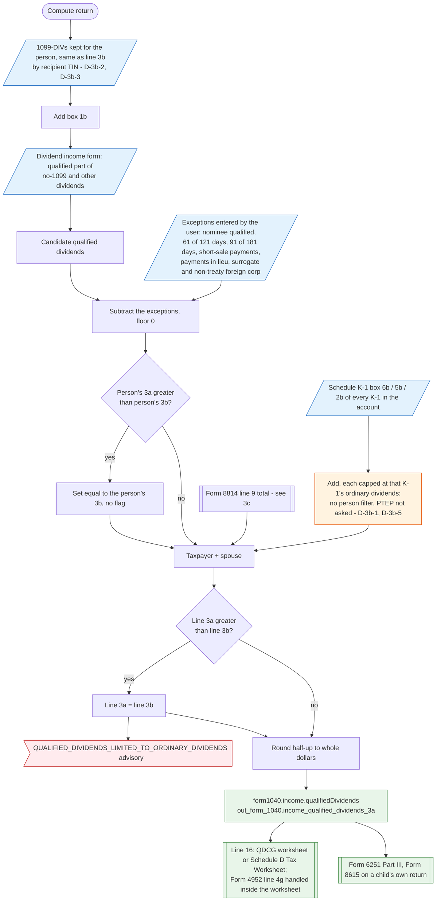

# Form 1040 line 3a — flowchart (as the code does it)

IRS rules: `C:\us-tax\new_lines\3a.md`. Code details and deviations: `C:\us-tax\new_knowledge\3a.md`.

Line 3a runs in the same pass as line 3b and keeps the same statements (recipient-TIN attribution, the per-person
"Yes" gate — D-3b-2, blank TIN — D-3b-3). Per person it adds 1099-DIV box 1b and the hand-entered qualified
dividends, subtracts the hand-entered exceptions (nominee, holding periods, short-sale related payments, payments
in lieu, surrogate and non-treaty foreign corporations), floors at 0 and caps at the person's line 3b without a
flag. At the return level it adds K-1 qualified dividends (each capped at that K-1's ordinary dividends; no person
filter — D-3b-1; PTEP not asked — D-3b-5) and Form 8814 line 9 (see `3c.md`), caps at line 3b with an advisory,
rounds, and stores `form1040.income.qualifiedDividends`. It is not added to line 9; it decides the line 16 worksheet.
A Form 4952 line 4g election does not reduce it.

Main code: `computeDividendForPerson` (`TaxReturnComputeService.java:19910`, line 3a at `:20060`),
`computeDividendIncome` (`TaxReturnComputeService.java:19695`).

Deviation ids in the chart (all recorded under line 3b): D-3b-1 (K-1 dividends not attributed to a person — same
root cause as D-1a-1), D-3b-2 (a person not answered Yes loses his or her 1099-DIVs), D-3b-3 (blank-TIN 1099-DIV),
D-3b-5 (PTEP). Line 3a has no deviation of its own; the Form 8814 election deviations are D-3c-1 … D-3c-3.
