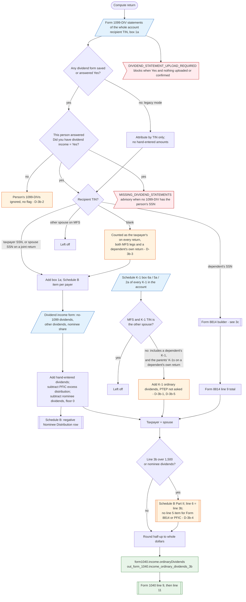

# Form 1040 line 3b — flowchart (as the code does it)

IRS rules: `C:\us-tax\new_lines\3b.md`. Code details and deviations: `C:\us-tax\new_knowledge\3b.md`.

The compute loads every Form 1099-DIV in the account (taxpayer's, spouse's and dependents'). For the taxpayer and
then the spouse (not on MFS) it keeps a 1099-DIV only when its recipient TIN is that person's SSN; a blank TIN goes
to the taxpayer (D-3b-3). A person whose dividend form is not answered Yes gets nothing when any dividend form exists
(D-3b-2). Each kept 1099-DIV adds box 1a; hand-entered dividends are added, a PFIC excess distribution and nominee
dividends are subtracted. At the return level the K-1 ordinary dividends of every K-1 in the account are added —
filtered only to drop the other spouse's on MFS (D-3b-1, PTEP not asked D-3b-5) — then Form 8814 line 9 (built for
each dependent whose SSN is on a 1099-INT/DIV, see `3c.md`). A dependent's 1099-DIV never enters line 3b directly.
The total is rounded and becomes `form1040.income.ordinaryDividends`, which feeds line 9 and Schedule B line 6.

Main code: `computeDividendForPerson` (`TaxReturnComputeService.java:19910`), `computeDividendIncome`
(`TaxReturnComputeService.java:19695`), `belongsToPerson` (`TaxReturnComputeService.java:36021`).

Deviation ids in the chart: D-3b-1 (K-1 dividends not attributed to a person — same root cause as D-1a-1),
D-3b-2 (a person not answered Yes loses his or her 1099-DIVs), D-3b-3 (blank-TIN 1099-DIV counted on every return),
D-3b-4 (Schedule B line 5 missing the Form 8814 and PFIC items), D-3b-5 (K-1 PTEP not asked). The Form 8814
election deviations D-3c-1 … D-3c-3 are in `3c.md`.
