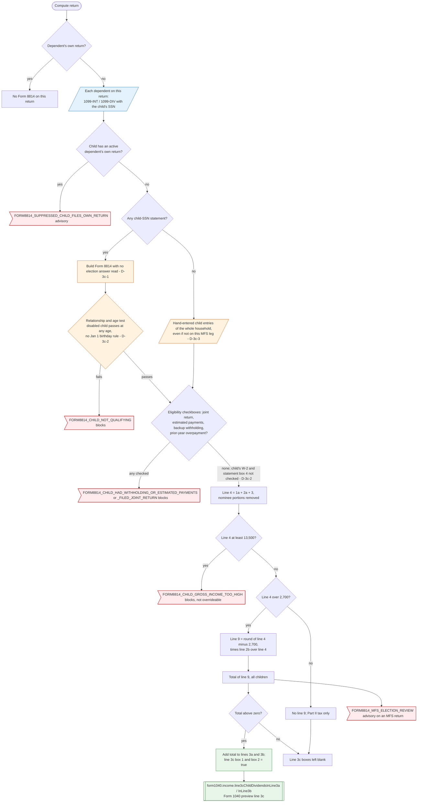

# Form 1040 line 3c — flowchart (as the code does it)

IRS rules: `C:\us-tax\new_lines\3c.md`. Code details and deviations: `C:\us-tax\new_knowledge\3c.md`.

On a parent's return the app builds a Form 8814 for every dependent whose SSN is on a 1099-INT or 1099-DIV — no
election answer is saved or read (D-3c-1) — unless the child has an active dependent's-own return. It checks
relationship and age (with a disabled-child exception and no January 1 birthday rule — D-3c-2), the four
eligibility checkboxes and the $13,500 limit, but not the child's other income or statement withholding (D-3c-2).
Hand-entered children are built even when they are not on this leg's dependent list, so on MFS both spouses can
report the same child (D-3c-3). When line 4 is over $2,700, line 9 = (line 4 − 2,700) × line 2b ÷ line 4. If the
total of line 9 is above zero, it is added to lines 3a and 3b and both line 3c boxes are set to true.

Main code: `computeChildInterestDividends` (`TaxReturnComputeService.java:24341`), `buildForm8814`
(`TaxReturnComputeService.java:24610`), checkboxes at `TaxReturnComputeService.java:19765` and `:19905`.

Deviation ids in the chart: D-3c-1 (Form 8814 built without an election), D-3c-2 (eligibility conditions not
checked from the data; disabled-child and January 1 age errors), D-3c-3 (hand-entered child reported on both MFS
legs).
