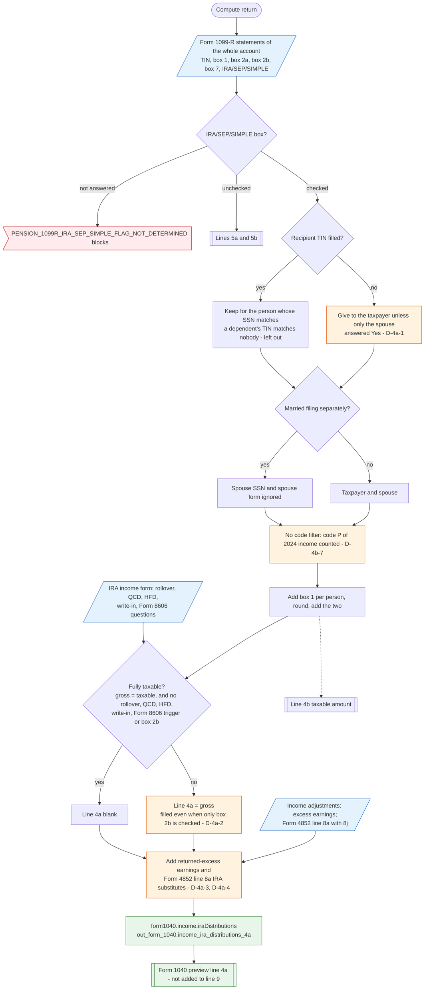

# Form 1040 line 4a — flowchart (as the code does it)

IRS rules: `C:\us-tax\new_lines\4a.md`. Code details and deviations: `C:\us-tax\new_knowledge\4a.md`.

The compute loads every Form 1099-R in the account. Only those with the IRA/SEP/SIMPLE box checked are used; a 1099-R
with that box unanswered blocks. Each one is given to the taxpayer or the spouse by its recipient TIN; a 1099-R with a
blank TIN goes to the taxpayer (D-4a-1 — a dependent's or, on MFS, the other spouse's blank-TIN 1099-R lands here).
No box 7 code is filtered out, so a code P 1099-R of 2024 income is counted (D-4b-7). Box 1 is added per person. If the
return is "fully taxable" (gross = taxable and no exception — where a checked box 2b counts as an exception, D-4a-2)
line 4a is left blank; otherwise it shows the gross. Returned-excess earnings and Form 4852 IRA substitutes are then
added (D-4a-3, D-4a-4). Line 4a is not added into line 9.

Main code: `computeIraDistributions` (`TaxReturnComputeService.java:20083`), `computeIraForPerson` (`:20906`),
`belongsToPersonByTinAndFallback` (`:36002`).

Deviation ids in the chart: D-4a-1 (blank TIN goes to the taxpayer — same root cause as D-1a-1), D-4a-2 (box 2b keeps
4a filled), D-4a-3 (augments make 4a partial), D-4a-4 (Form 4852 on top of a 1099-R on file), D-4b-7 (code P counted).
