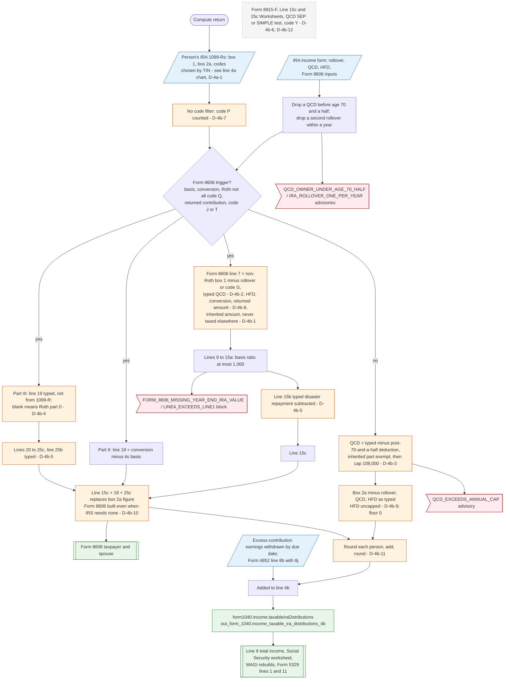

# Form 1040 line 4b — flowchart (as the code does it)

IRS rules: `C:\us-tax\new_lines\4b.md`. Code details and deviations: `C:\us-tax\new_knowledge\4b.md`.

Per person, the IRA 1099-Rs (chosen as in the line 4a chart) give Σ box 2a. The IRA income form is first cleaned: a QCD
by an owner under 70½ (or made before the 70½ date) and a second IRA-to-IRA rollover within a year are removed. Without
a Form 8606 trigger, line 4b is box 2a less the rollover, the QCD (offset by this year's post-70½ deductible
contribution, then capped at $108,000 — D-4b-3) and the HFD (uncapped — D-4b-9), floored at 0. With a trigger, Form
8606 is built and lines 15c + 18 + 25c replace that figure: line 7 subtracts the typed QCD (D-4b-2) and the inherited
amount (D-4b-1), line 15b / 25b subtract a "disaster repayment" figure (D-4b-5), line 19 is typed (D-4b-4). The persons
are added, earnings on an excess withdrawn by the due date and Form 4852 IRA substitutes are added, and the rounded
result is line 4b, which feeds line 9.

Main code: `computeIraForPerson` (`TaxReturnComputeService.java:20906-21318`), `buildForm8606` (`:21344-21450`),
`computeIraDistributions` (`:20083-20659`).

Deviation ids in the chart: D-4b-1 (inherited amount lost on the Form 8606 path), D-4b-2 (QCD cap and offset lost on
the Form 8606 path), D-4b-3 (QCD offset order, inherited carve-out, current year only), D-4b-4 (Roth line 19 typed),
D-4b-5 (line 15b / 25b used for repayments), D-4b-6 (Form 8915-F and worksheets not supported), D-4b-7 (code P),
D-4b-8 (returned amount including earnings), D-4b-9 (HFD uncapped), D-4b-10 (unneeded Form 8606), D-4b-11 (rounding),
D-4b-12 (QCD from an ongoing SEP / SIMPLE, code Y), D-4a-1 (blank TIN).
