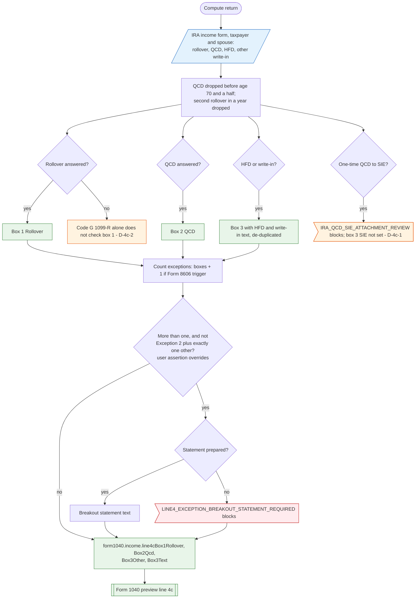

# Form 1040 line 4c — flowchart (as the code does it)

IRS rules: `C:\us-tax\new_lines\4c.md`. Code details and deviations: `C:\us-tax\new_knowledge\4c.md`.

Each person's IRA income answers (after the QCD age test and the one-rollover-a-year test) set three flags: rollover,
QCD, HFD-or-write-in. They are OR-ed across the spouses (spouse ignored on MFS) into boxes 1, 2 and 3, with "HFD" and
any write-in text joined. The number of exceptions (boxes plus one for a Form 8606 trigger) decides whether a breakout
statement is required; if it is and the user has not confirmed it, compute blocks. The SIE answer raises only its
attachment flag — box 3 and "SIE" are not set (D-4c-1); a code G 1099-R alone does not check box 1 (D-4c-2).

Main code: `computeIraDistributions` (`TaxReturnComputeService.java:20171-20244`), per-person flags (`:21033-21041`,
`:21193-21200`), output (`:18665-18694`).

Deviation ids in the chart: D-4c-1 (SIE does not set box 3 / "SIE"), D-4c-2 (code G does not check box 1).
