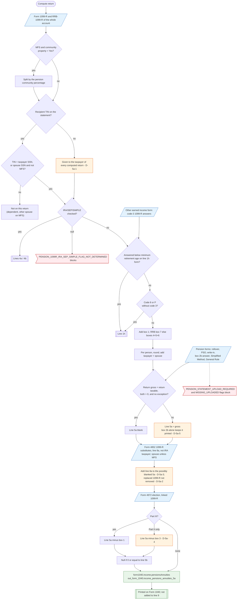

# Form 1040 line 5a — flowchart (as the code does it)

IRS rules: `C:\us-tax\new_lines\5a.md`. Code details and deviations: `C:\us-tax\new_knowledge\5a.md`.

The compute loads every Form 1099-R and RRB-1099-R of the account (split first on an MFS community-property return).
For the taxpayer and the spouse (spouse skipped on MFS) it keeps the statements whose recipient TIN is that person's
— on every filing status, so a dependent's statement with the dependent's SSN never reaches the parent's line 5a;
a statement **without** a TIN goes to the taxpayer of whatever return is being computed (D-5a-1). IRA/SEP/SIMPLE
entries go to line 4a, entries answered "below minimum retirement age" on the Other earned income form go to line 1h,
codes 8 / P are skipped. Box 1 (RRB: box 7, else 4 + 5 + 6) is added per person and the two are added. Line 5a is
blanked when the return's pensions are fully taxable and no exception applies (a box-2b entry always counts as one —
D-5a-5). Form 4852 1099-R substitutes are added on top (D-5a-2, D-5a-3), and a Form 4972 lump sum is taken out after
line 15 (D-5a-4).

Main code: `computePensionAnnuities` (`TaxReturnComputeService.java:21529`), `computePensionForPerson` (`:21937`),
`augmentPensionWithForm4852` (`:46967`), `adjustPensionLinesForForm4972` (`:52022`).

Deviation ids in the chart: D-5a-1 (statement without a recipient TIN goes to the taxpayer of every return — same root
cause as D-1a-1), D-5a-2 (Form 4852 added on top of the 1099-R it replaces), D-5a-3 (Form 4852 merge loses a fully
taxable 1099-R's gross), D-5a-4 (Form 4972 Part II leaves box 1 − box 3 on line 5a), D-5a-5 (box 2b keeps line 5a
printed).
