# Form 1040 line 5b — flowchart (as the code does it)

IRS rules: `C:\us-tax\new_lines\5b.md`. Code details and deviations: `C:\us-tax\new_knowledge\5b.md`.

After the routing of line 5a (TIN, IRA, line 1h, codes 8 / P — see `5a.md`), each person's statements are pooled.
The starting figure is the sum of box 2a — box 1 only when no statement of the person has a box 2a, so a blank box 2a
next to a filled one adds nothing (D-5b-1, D-5b-13) — plus RRB boxes 4 + 5 + 6. Per-annuity streams replace it (with
uncovered statements at box 1 — D-5b-7); otherwise a person-level Simplified Method or General Rule replaces it (D-5b-6,
D-5b-8, D-5b-9). A reported rollover then recomputes everything from box 1 (D-5b-2, D-5b-3). The PSO exclusion takes
up to $3,000 — $3,000 when the premiums are blank (D-5b-4, D-5b-5). Spouses are rounded and added (D-5b-14); Form 4852
line 8b is added; a Form 4972 lump sum is removed after line 15 (D-5b-11).

Main code: `computePensionForPerson` (`TaxReturnComputeService.java:21937-22440`), worksheets `:22447-22678`,
`adjustPensionLinesForForm4972` (`:52022`).

```mermaid
flowchart TD
    S([Statements kept for the person - see line 5a chart]) --> ST[/"1099-R box 1, 2a, 2b, 5, 6; RRB boxes 3 to 7"/]:::input
    ST --> POOL["Sum box 1; sum box 2a only where filled;<br/>NUA added when elected and 2a filled"]
    POOL --> ANY{"Any statement of the person<br/>has box 2a?"}
    ANY -->|yes| B2A["Start = sum of box 2a<br/>blank-2a statements add 0 - D-5b-1"]:::warn
    ANY -->|no| B1["Start = box 1, no worksheet required - D-5b-13"]:::warn
    B2A --> RRB
    B1 --> RRB["Add RRB boxes 4+5+6, else box 7"]
    PF[/"Pension form: streams, method, cost, age,<br/>months, prior recovery, rollover, PSO"/]:::input --> STR
    RRB --> STR{"Per-annuity streams<br/>entered?"}
    STR -->|yes| PS["Each stream: Simplified or General Rule;<br/>uncovered statements at box 1 - D-5b-7"]:::warn
    STR -->|no| SM{"Simplified Method?"}
    SM -->|yes| SMC["Cost / factor x months, cap cost minus prior;<br/>after-1996 column only, no pre-1987 rule - D-5b-8;<br/>UI help: net cost, quarterly = 4 - D-5b-9"]:::warn
    SMC --> SMP["Applied to all the person's statements - D-5b-6"]:::warn
    SMP --> GR
    SM -->|no| GR{"General Rule?"}
    GR -->|yes| GRC["Typed payments minus payments x ratio;<br/>replaces the whole pool - D-5b-6"]:::warn
    GR -->|no| ROL
    GRC --> ROL
    PS --> ROL{"Rollover reported?"}
    ROL -->|yes| ROLC["Box 1 minus rollover minus box 5, plus RRB;<br/>worksheet and NUA exclusion discarded - D-5b-2;<br/>Roth destination not asked - D-5b-3"]:::warn
    ROL -->|no| NET["Box 2b entries: subtract their box 5<br/>when no worksheet"]
    ROLC --> PSO
    NET --> PSO{"PSO eligible and elected?"}
    PSO -->|yes| PSOC["Minus min of premiums or 3,000;<br/>blank premiums = 3,000 - D-5b-4;<br/>plan and medical bar not checked - D-5b-5"]:::warn
    PSO -->|no| RND
    PSOC --> RND["Round per person, add spouses - D-5b-14"]:::warn
    RND --> F4852[/"Form 4852 line 8b, not IRA"/]:::input
    F4852 --> F4972{"Form 4972 elected?"}
    F4972 -->|"Part III"| P3["Minus box 2a and elected NUA"]
    F4972 -->|"Part II only"| P2["Minus box 3"]
    F4972 -->|no| OUT
    P3 --> CAS["Same amount off line 9, AGI, line 15;<br/>AGI-based figures not redone - D-5b-11"]:::warn
    P2 --> CAS
    CAS --> OUT["form1040.income.taxablePensionsAnnuities<br/>out_form_1040.income_taxable_pensions_annuities_5b"]:::output
    OUT --> L9[["Form 1040 line 9, then AGI and taxable income"]]:::output
    OUT --> F5329[["Form 5329 early-distribution base"]]
    MF>Method flags: both selected, inputs missing, ratio range, per-annuity limitation]:::flag
    PF -.-> MF
    UPF>Upload gate reads the taxpayer form only - D-5b-12]:::flag
    PF -.-> UPF
    WS["Worksheet lines 10-11 not kept or carried to 2026 - D-5b-10"]:::oos

    classDef input fill:#e3f2fd,stroke:#1565c0
    classDef flag fill:#ffebee,stroke:#c62828
    classDef output fill:#e8f5e9,stroke:#2e7d32
    classDef warn fill:#fff3e0,stroke:#e65100
    classDef oos fill:#f5f5f5,stroke:#9e9e9e,stroke-dasharray: 5 5
```

Deviation ids in the chart: D-5b-1 (blank box 2a dropped next to a filled one), D-5b-2 (rollover discards the
worksheet and NUA exclusion), D-5b-3 (Roth rollover tax free), D-5b-4 (blank PSO premiums = $3,000), D-5b-5 (PSO plan /
medical conditions), D-5b-6 (person-level methods on the pool; General Rule replaces it), D-5b-7 (streams leave other
statements at box 1), D-5b-8 (table column, Table 2 date, pre-1987, eligibility), D-5b-9 (UI help for cost and months),
D-5b-10 (no worksheet kept), D-5b-11 (Form 4972 cascade), D-5b-12 (spouse-only upload gate), D-5b-13 (blank box 2a
without a worksheet), D-5b-14 (rounding per person).
