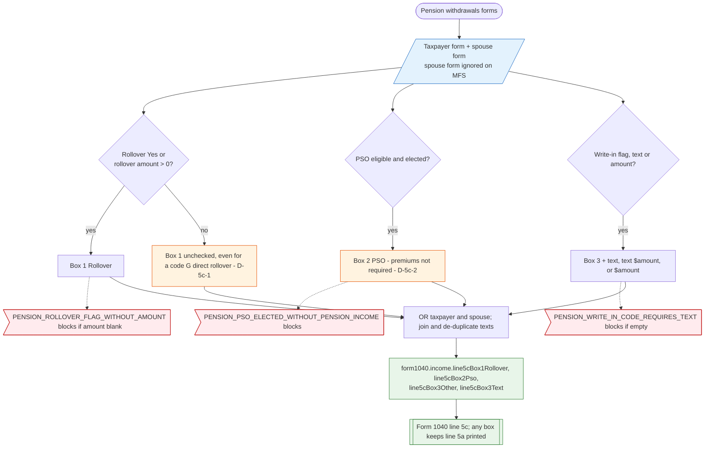

# Form 1040 line 5c — flowchart (as the code does it)

IRS rules: `C:\us-tax\new_lines\5c.md`. Code details and deviations: `C:\us-tax\new_knowledge\5c.md`.

Each box is set from the Pension withdrawals form answers of the taxpayer and (except on MFS) the spouse, OR-ed into
one set for the return. Nothing is read from the Forms 1099-R: a code-G direct rollover leaves box 1 unchecked unless
the user answers the rollover question (D-5c-1); box 2 follows the PSO election even with no premiums (D-5c-2).

Main code: `computePensionForPerson` (`TaxReturnComputeService.java:22226-22310`), return level `:21775-21778`.

Deviation ids in the chart: D-5c-1 (direct rollover not detected from code G / H), D-5c-2 (box 2 without premiums).
