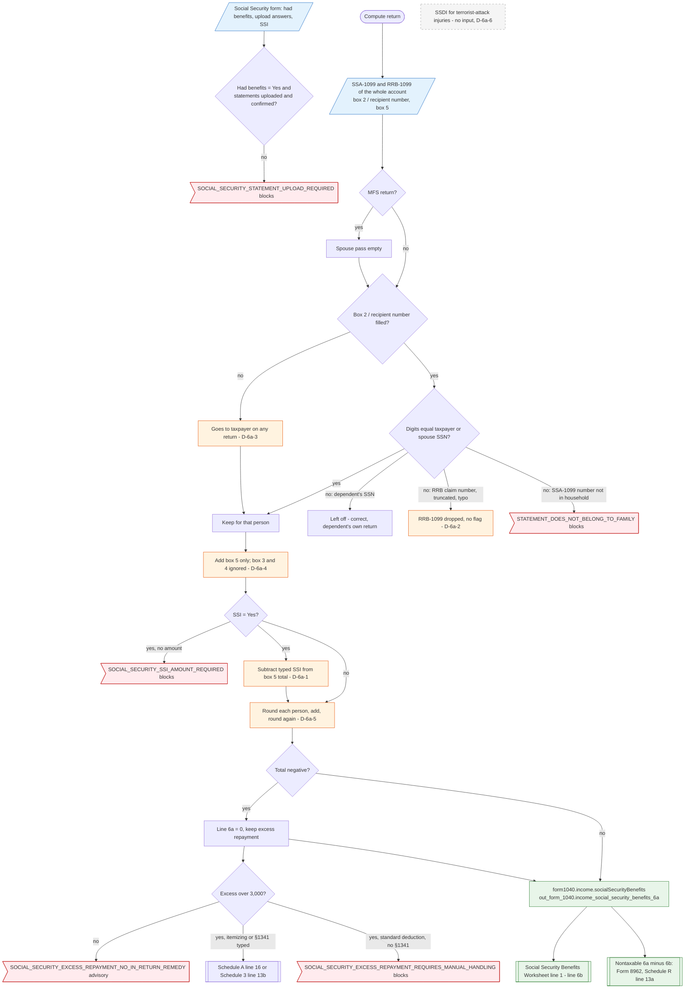

# Form 1040 line 6a — flowchart (as the code does it)

IRS rules: `C:\us-tax\new_lines\6a.md`. Code details and deviations: `C:\us-tax\new_knowledge\6a.md`.

The compute loads every SSA-1099 and RRB-1099 stored in the account for 2025 and runs a taxpayer pass and a spouse
pass (the spouse pass is empty on MFS). A statement whose box 2 / recipient number equals the taxpayer's or spouse's
SSN goes to that person; a dependent's SSA-1099 is therefore left off the parent's return (correct), but an RRB-1099
whose number is anything other than the exact SSN is dropped silently (D-6a-2), and a statement with a blank number
goes to the taxpayer on any return (D-6a-3). Only box 5 is read (D-6a-4). A typed SSI amount is subtracted, although box 5
never contains SSI (D-6a-1). Each person is rounded before the persons are added (D-6a-5); a negative total becomes 0 and the
excess repayment goes to Schedule A line 16 or a §1341 credit. The result is `form1040.income.socialSecurityBenefits`
and line 1 of the worksheet for line 6b.

Main code: `computeSocialSecurityBenefits` (`TaxReturnComputeService.java:33715`) and `computeSocialSecurityForPerson`
(`TaxReturnComputeService.java:34321`).

Deviation ids in the chart: D-6a-1 (SSI subtracted from box 5), D-6a-2 (RRB-1099 with a non-SSN identifier dropped),
D-6a-3 (blank box 2 goes to the taxpayer), D-6a-4 (box 5 only), D-6a-5 (per-person rounding), D-6a-6 (no SSDI
terrorist-attack exclusion).
