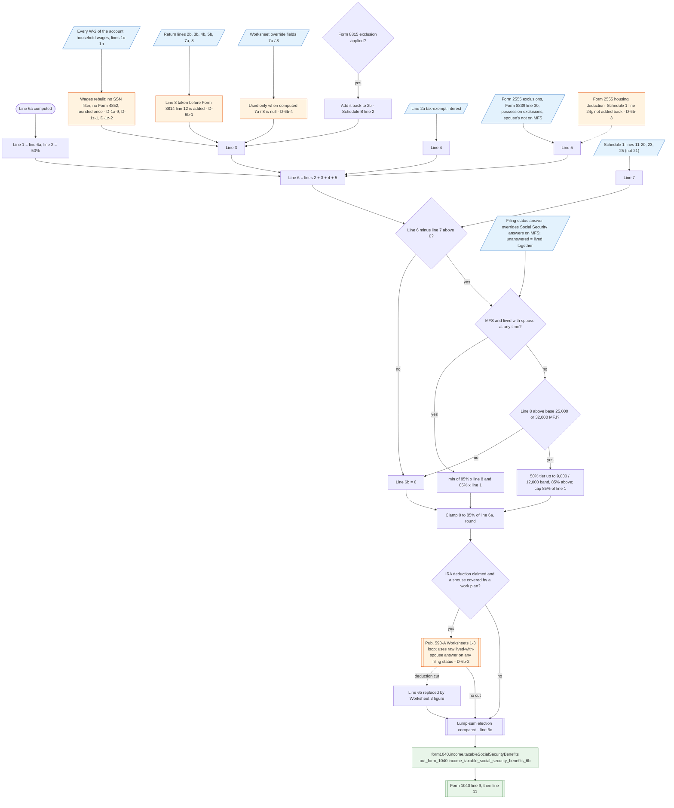

# Form 1040 line 6b — flowchart (as the code does it)

IRS rules: `C:\us-tax\new_lines\6b.md`. Code details and deviations: `C:\us-tax\new_knowledge\6b.md`.

One routine (Pub. 915 Worksheet 1) runs for every return after the income lines and the Schedule 1 adjustments.
Line 1 is line 6a. Line 3 is rebuilt: wages from every W-2 in the account (no person filter, no Form 4852, rounded
once — D-1a-9, D-1z-1, D-1z-2), the return's lines 2b–7a, and line 8 **before** the Form 8814 child amount is added
(D-6b-1); a hand "override" fills line 7a / 8 only when the computed value is null (D-6b-4); Form 8815's exclusion is
added back. Line 5 adds back the Form 2555 and Form 8839 exclusions and possession exclusions, but not the Form 2555
housing deduction (D-6b-3). Line 7 subtracts Schedule 1 lines 11–20, 23, 25. MFS-lived-together takes 85%; otherwise
the $25,000 / $32,000 base and the 50% / 85% tiers, capped at 85% of benefits. With an IRA deduction and work-plan
coverage, the Pub. 590-A loop may replace line 6b, using a "lived with spouse" answer that is not checked against the
filing status (D-6b-2). The lump-sum election is compared last (`6c.md`). The result goes to line 9.

Main code: `computeSocialSecurityBenefits` (`TaxReturnComputeService.java:33960-34095`),
`computeTaxableSocialSecurityNormal` (`TaxReturnComputeService.java:34824`), Pub. 590-A coordination
(`TaxReturnComputeService.java:4484`).

Deviation ids in the chart: D-6b-1 (Form 8814 child amount added after the worksheet), D-6b-2 (Pub. 590-A loop uses
the lived-with-spouse answer on non-MFS returns), D-6b-3 (housing deduction not added back), D-6b-4 (worksheet
"override" fields), and the inherited D-1a-9, D-1z-1, D-1z-2 (rebuilt wages).
