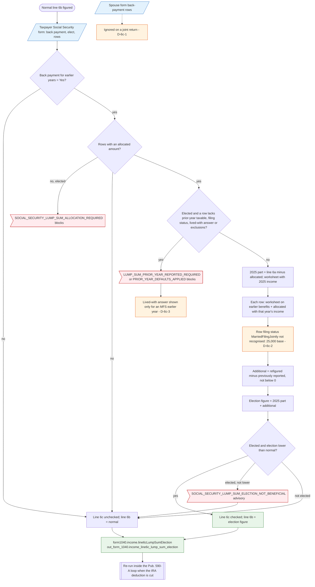

# Form 1040 line 6c — flowchart (as the code does it)

IRS rules: `C:\us-tax\new_lines\6c.md`. Code details and deviations: `C:\us-tax\new_knowledge\6c.md`.

Only the taxpayer's Social Security form is read (the spouse form's back-payment rows are ignored on a joint return,
D-6c-1). If the benefits include a back payment, the app figures the 2025 part of the benefits with 2025 income and
adds, for each typed earlier-year row, that year's refigured taxable benefits less what was already reported. A row
whose earlier year was picked as "Married filing jointly" gets the $25,000 base (D-6c-2). Four blocking flags force
the row details; one of them needs an answer the form shows only for an earlier MFS year (D-6c-3). Line 6c is checked
and line 6b takes the election figure only when the taxpayer elected and it is lower.

Main code: `TaxReturnComputeService.java:34097-34238` and `computeTaxableSocialSecurityLumpSum`
(`TaxReturnComputeService.java:35011`).

Deviation ids in the chart: D-6c-1 (spouse form rows ignored on a joint return), D-6c-2 (earlier joint year gets the
single base), D-6c-3 (election blocked through the UI for a non-MFS earlier year).
