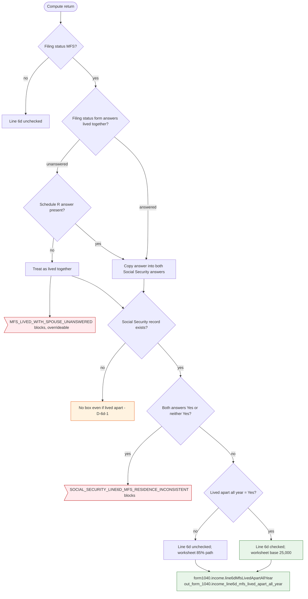

# Form 1040 line 6d — flowchart (as the code does it)

IRS rules: `C:\us-tax\new_lines\6d.md`. Code details and deviations: `C:\us-tax\new_knowledge\6d.md`.

On an MFS return the Filing status answer "lived together at any time in 2025" decides both Social Security answers;
without it a Schedule R answer is used; with no answer at all the return is treated as "lived together" and an
overrideable blocking flag asks for it. Line 6d is checked when the return is MFS and "lived apart all year" is Yes.
Contradictory answers block. The box exists only inside the Social Security computation (D-6d-1).

Main code: `prepare` (`TaxReturnComputeService.java:2740-2815`) and `computeSocialSecurityBenefits`
(`TaxReturnComputeService.java:33890-33958`).

Deviation id in the chart: D-6d-1 (no box without a Social Security record).
