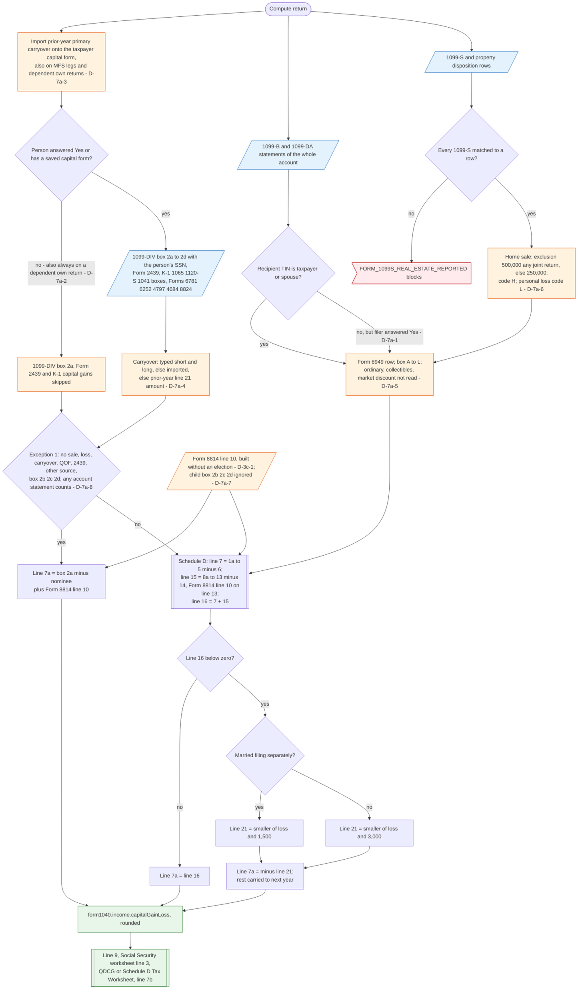

# Form 1040 line 7a — flowchart (as the code does it)

IRS rules: `C:\us-tax\new_lines\7a.md`. Code details and deviations: `C:\us-tax\new_knowledge\7a.md`.

The household's prior-year carryover is imported onto the taxpayer's capital form on every return of the account,
including MFS legs and dependents' own returns (D-7a-3); a typed prior-year line 21 amount is used as a carryover
when the split amounts are blank (D-7a-4). For each person, capital gain distributions, Form 2439 and K-1 capital
gains are read only if that person's Capital gain/loss form exists (D-7a-2). 1099-B / 1099-DA sales become Form
8949 rows — including a dependent's when the filer answered Yes (D-7a-1), and without reading the ordinary /
collectibles boxes (D-7a-5); 1099-S property rows add home sales with a $500,000 / $250,000 exclusion (D-7a-6).
If Exception 1 holds, line 7a = box 2a − nominee + Form 8814 line 10. Otherwise Schedule D is built: line 16 =
short-term + long-term; a loss is limited to $3,000 ($1,500 MFS); the rest carries to next year. Line 7a goes to
line 9, the Social Security worksheet, the line 16 worksheets and line 7b.

Main code: `computeCapitalGainLoss` (`TaxReturnComputeService.java:23515`), `computeCapitalForPerson` (`:24734`),
`belongsToEitherCapitalPersonByKey` (`:26252`), carryover import (`:2714`), line 7a (`:24025-24077`).

Deviation ids in the chart: D-7a-1 (dependent's 1099-B / 1099-DA on the parent's return), D-7a-2 (distributions and
K-1 capital gains skipped without a capital form; dependent's own return), D-7a-3 (carryover imported on MFS legs
and dependents' returns), D-7a-4 (prior line 21 used as carryover), D-7a-5 (1099-B ordinary / collectibles boxes),
D-7a-6 (home-sale cap), D-7a-7 (child's 2b–2d parts), D-7a-8 (Schedule D forced by any account statement),
D-3c-1 (Form 8814 without an election). Not shown: D-7a-9 (K-1 1041 box 11 C / D), D-7a-10 (Form 4684 short-term
gain as long-term).
