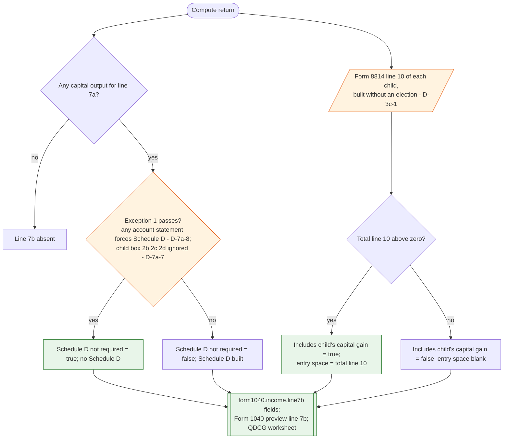

# Form 1040 line 7b — flowchart (as the code does it)

IRS rules: `C:\us-tax\new_lines\7b.md`. Code details: `C:\us-tax\new_knowledge\7b.md`.

Both boxes come out of `computeCapitalGainLoss`. "Schedule D not required" is true when the app's Exception 1 test
passes — the test counts any capital statement in the account (D-7a-8) and ignores a child's box 2b–2d (D-7a-7).
"Includes child's capital gain or (loss)" is true when the Form 8814 line 10 total is above zero — Forms 8814 are
built without an election (D-3c-1) — and the entry space then holds that total.

Main code: `TaxReturnComputeService.java:3670` (line 10 total), `:23981` (Exception 1), `:24255` and `:24277`
(values).

Deviation ids in the chart: D-7a-7, D-7a-8 (inputs to the Exception 1 test), D-3c-1 (Form 8814 built without an
election).
