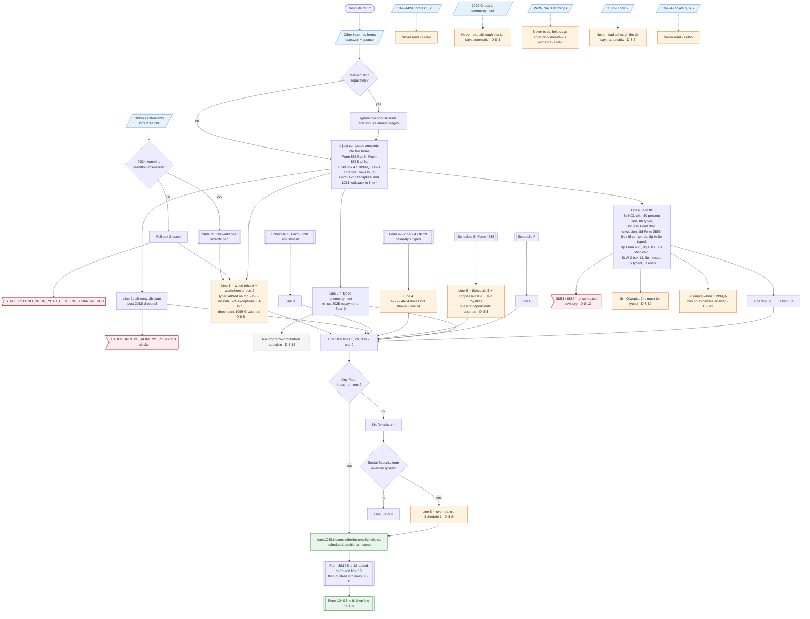

# Form 1040 line 8 — flowchart (as the code does it)

IRS rules: `C:\us-tax\new_lines\8.md`. Code details and deviations: `C:\us-tax\new_knowledge\8.md`.

Before the main method runs, other forms write their results into the "Other incomes" maps: Form 8889 and Form 8853
income (8f, 8e), the 2025 state-refund worksheet (line 1, only when the 2024 itemizing question is answered), the
Form 1098 box 4 recovery, 1099-Q, Form 8621 and excess medical rows (8z), Form 4797 recapture / §1231 / casualty
amounts (line 4). `computeOtherIncomes` then builds every Schedule 1 Part I line: typed amounts of both spouses (only
the taxpayer's on MFS) plus computed Schedules C, E, F, K-1 income, Form 2555, the NOL limit, Form 982 and the
§461(l) add-back. Three statements the IRS points to are never read — 1099-G box 1 (D-8-1), 1099-C box 2 (D-8-2) and
W-2G box 1 (D-8-3) — nor is 1099-MISC (D-8-4). Line 9 sums 8a–8z, line 10 sums lines 1–7 and 9, and Form 1040 line
8 takes line 10 (or, with no Schedule 1 at all, the Social Security form's override — D-8-9). Form 8814 line 12 is
added to 8z and line 10 afterwards and pushed back into lines 8, 9 and 11.

Main code: `computeOtherIncomes` (`TaxReturnComputeService.java:32015`), line 8 in `buildIncome`
(`TaxReturnComputeService.java:18476`), Form 8814 sync (`TaxReturnComputeService.java:5085-5125`).

Deviation ids in the chart: D-8-1 (1099-G box 1), D-8-2 (1099-C box 2), D-8-3 (W-2G box 1), D-8-4 (1099-MISC),
D-8-5 (1099-G boxes 5–7), D-8-6 (typed refund added to box 2), D-8-7 (refund exceptions), D-8-8 (dependents'
statements), D-8-9 (line 8 without Schedule 1), D-8-10 (Olympic 24c), D-8-11 (ABLE), D-8-12 (unemployment program
contributions), D-8-13 (8853 / 8889 advisory), D-8-14 (presentation). Line 8 also carries D-1a-2, D-1a-5, D-1a-9
(8t / 8u), D-1d-3 (8s) and D-3c-1 … D-3c-3 (Form 8814 on 8z).
