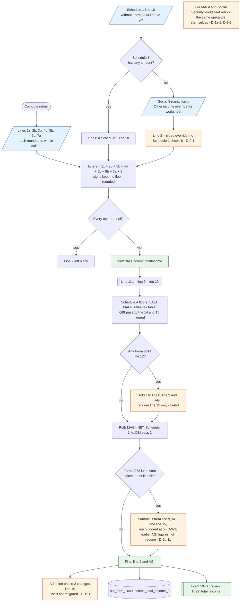

# Form 1040 line 9 — flowchart (as the code does it)

IRS rules: `C:\us-tax\new_lines\9.md`. Code details and deviations: `C:\us-tax\new_knowledge\9.md`.

`buildIncome` rounds lines 1z, 2b, 3b, 4b, 5b, 6b and 7a, takes line 8 from Schedule 1 line 10 — or, when Schedule 1
is empty, from the "Other income override" typed on the Social Security form (D-9-1) — and adds the eight with their
signs, no floor. The total is stored as `form1040.income.totalIncome` (null when every operand is null) and becomes
the start of line 11a. Two later steps change it in place: the Form 8814 line 12 amount is added after the
deductions and other early AGI-based figures were made (D-9-3), and the Form 4972 lump sum is subtracted with a
floor at zero (D-9-2; AGI-based figures not redone, D-5b-11). The adoption phase-2 change to line 1f never reaches
line 9 (D-1f-1).

Main code: `buildIncome` (`TaxReturnComputeService.java:18571`), Form 8814 patch (`:5086-5145`), Form 4972 patch
(`:6059-6094`).

Deviation ids in the chart: D-9-1 (typed Social Security override becomes line 8), D-9-2 (Form 4972 patch floors
line 9 and AGI at 0), D-9-3 (Form 8814 line 12 added after the early AGI-based figures), plus D-5b-11, D-1f-1 and
D-1z-1 recorded on lines 5b, 1f and 1z.
