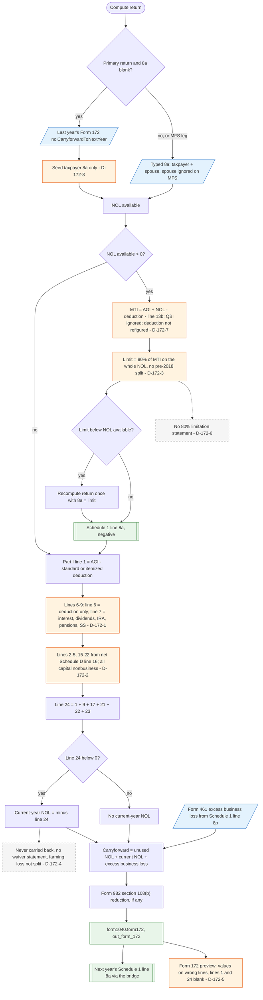

# Form 172 / NOL — flowchart (as the code does it)

IRS rules: `C:\us-tax\new_lines\forms\172.md`. Code details and deviations: `C:\us-tax\new_knowledge\forms\172.md`.

On the primary return a blank Schedule 1 line 8a is filled from last year's persisted Form 172 carryforward (user
entry wins; spouse form and MFS legs never import — D-172-8). The NOL available is limited to 80% of taxable income
figured without the NOL and QBI deductions, using the deduction already figured with the NOL in AGI (D-172-7) and with
no pre-2018 / post-2017 split (D-172-3); if the limit binds, the whole return is computed again with the capped line 8a.
Then Part I figures a current-year NOL from line 1 (AGI − deduction), a nonbusiness add-back that only knows the
standard / itemized deduction and five income items (D-172-1), the capital-loss lines with every capital item treated
as nonbusiness (D-172-2), the §1202 exclusion and the NOL-deduction add-back. The carryforward is unused NOL + Part I
NOL + the Form 461 excess business loss, less any Form 982 reduction; it is never carried back, even for a farming loss
(D-172-4). The preview prints the figures on the wrong lines (D-172-5) and no 80% statement is produced (D-172-6).

Main code: `TaxReturnComputeService.java:7388-7509` (§172 block), `:1111-1124` and `:2327-2340` (import), `:32346-32354`
(line 8a), `:55460-55464` (Form 982).

Deviation ids in the chart: D-172-1 (nonbusiness lines incomplete), D-172-2 (business capital items), D-172-3 (no NOL
vintage), D-172-4 (no farming carryback), D-172-5 (preview line placement), D-172-6 (no 80% statement), D-172-7 (80%
base uses the post-NOL deduction), D-172-8 (bridge / marital-status ownership).
