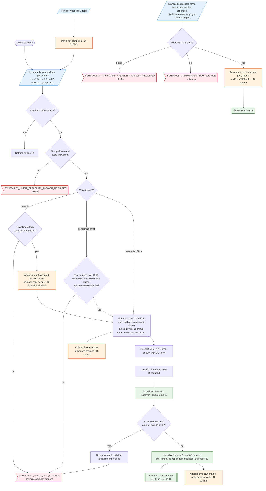

# Form 2106 — flowchart (as the code does it)

IRS rules: `C:\us-tax\new_lines\forms\2106.md`. Code details and deviations: `C:\us-tax\new_knowledge\forms\2106.md`.

For each person (taxpayer; spouse unless married filing separately) the compute reads the typed Form 2106 Part I
amounts from the Income adjustments form. Line 1 (vehicle) is a typed total — Part II is not computed (D-2106-3). If
any amount is present, the line 12 group must be chosen and its tests answered, or the return is blocked; a failed
test drops the amounts with an advisory. A reservist's per diem / mileage caps are not checked (D-2106-2), and one
group takes the whole amount (D-2106-6). Column A (lines 1–4) less the non-meal reimbursement and column B (meals) less
the meal reimbursement are each floored at zero — a column A excess is not added to line 1a (D-2106-1) — meals are cut
to 50% (80% with the DOT box), and the sum is Schedule 1 line 12. A performing artist whose AGI plus the deduction is
over $16,000 is refused on a second compute pass. Only an "attach Form 2106" marker is produced (D-2106-5).
Impairment-related work expenses take a separate path to Schedule A line 16 (D-2106-4).

Main code: `withLine12Eligibility` (`TaxReturnComputeService.java:10298`), `form2106Line10`
(`TaxReturnComputeService.java:52379`), line 12 (`TaxReturnComputeService.java:32857`).

Deviation ids in the chart: D-2106-1 (column A excess not income), D-2106-2 (reservist caps unchecked), D-2106-3 (Part
II not computed), D-2106-4 (impairment path skips Form 2106), D-2106-5 (form not produced), D-2106-6 (one group takes the
whole amount).
