# Form 2441 — flowchart (as the code does it)

IRS rules: `C:\us-tax\new_lines\forms\2441.md`. Code details and deviations: `C:\us-tax\new_knowledge\forms\2441.md`.
Part III in detail: `C:\us-tax\new_flowcharts\1e.md`.

On a joint return the two "Child and dependent care" forms are merged (a spouse row for a child already on the
taxpayer form is dropped, D-2441-9). The qualifying-person list is checked against the family: wrong SSN, age 13+
not disabled (a child who turned 13 in 2025 included, D-2441-3) and a disabled person resident six months or less
block the return; there is no custodial-parent rule (D-2441-4). Part III runs first. Line 3 is line 31 when W-2 box 10
exists (D-2441-6), else the expenses capped at $3,000 / $6,000. Earned income is the Part III figure (W-2 box 1 by
SSN, tips, lines 1g / 1h, typed extra earned income that only benefit recipients can enter, D-2441-1; the account's
whole W-2 total when the filer has none, D-2441-2). Once AGI and line 18 exist, phase 2 applies the AGI decimal,
adds line 9b (Worksheet A or an estimate, D-2441-7), limits the credit to line 18 less the foreign tax credit and
Form 8978, and puts line 11 on Schedule 3 line 2. MFS without the separation answer gets no credit (D-2441-5: one
of the three tests is not asked). Providers are never checked (D-2441-8).

Main code: `computeDependentCareBenefits` (`TaxReturnComputeService.java:38771-39263`), `finalizeForm2441PartII`
(`:44415-44493`), `applyChildDependentCareCredit` (`:44495-44513`), `validateQualifyingPersons` (`:41776-41900`).

```mermaid
flowchart TD
    S([Compute return]) --> CCE[/"Child and dependent care forms<br/>taxpayer + spouse tab"/]:::input
    CCE --> MRG{"Joint return?"}
    MRG -->|yes| MERGE["Merge: providers and persons appended;<br/>spouse row for a child already listed dropped - D-2441-9"]:::warn
    MRG -->|no| CARE
    MERGE --> CARE{"Paid for care = No?"}
    CARE -->|yes| NOCR["No qualifying persons, credit disallowed"]
    CARE -->|no| QP[/"Qualifying persons: SSN, amount paid, over 12 and disabled"/]:::input
    DEP[/"Dependents: SSN, date of birth, months lived with you"/]:::input --> VAL
    QP --> VAL{"SSN is you, spouse or a dependent?"}
    VAL -->|no| NIF>QUALIFYING_PERSON_NOT_IN_FAMILY blocks - custodial parent after Form 8332 blocked - D-2441-4]:::flag
    VAL -->|yes| AGE{"Age at 31 Dec 13+ and not marked disabled?"}
    AGE -->|yes| O12>OVER_12_NOT_DISABLED blocks - also a child who turned 13 in 2025 - D-2441-3]:::flag
    AGE -->|no| RES{"Marked disabled and lived with you 6 months or less?"}
    RES -->|yes| NRES>NOT_RESIDENT_MORE_THAN_HALF_YEAR blocks]:::flag
    RES -->|"no - noncustodial parent not stopped - D-2441-4"| CNT["Count persons with SSN or amount;<br/>line 30 = sum of amounts"]
    PROV[/"Care providers"/]:::input --> P1["Part I: first three providers copied, never checked - D-2441-8"]:::warn
    CNT --> P3[[Part III lines 12-31 - see 1e flowchart]]
    W2[/"W-2 box 10 of filer and spouse"/]:::input --> P3
    P3 --> L1E[["Line 26 to Form 1040 line 1e"]]:::output
    P3 --> HB{"W-2 box 10 over 0?"}
    HB -->|yes| L3A["Line 3 = line 31 = min of 6,000 or 3,000 less line 28, and line 30"]
    HB -->|"no - grace-period-only benefits ignored - D-2441-6"| L3B["Line 3 = min of line 30 and 3,000 / 6,000"]:::warn
    EI[/"W-2 box 1 by SSN, tips, line 1g, line 1h,<br/>extra earned income only if benefits = Yes"/]:::input --> EARN["Lines 4 / 5 = Part III lines 18 / 19<br/>no SE earnings for a credit-only filer - D-2441-1<br/>D-1e-3 D-1e-4 D-1e-5 D-1e-6 D-1e-10"]:::warn
    EARN --> FB{"Any W-2 with filer or spouse SSN?"}
    FB -->|no| ALLW2["Use every W-2 in the account, a dependent's too - D-2441-2"]:::warn
    FB -->|yes| L6
    ALLW2 --> L6
    L3A --> L6["Line 6 = smallest of lines 3, 4, 5"]
    L3B --> L6
    L6 --> MFS{"MFS without the separation answer?<br/>question omits the home-cost test - D-2441-5"}
    MFS -->|yes| NOCR
    MFS -->|no| PH2["Phase 2, after AGI and Form 1040 line 18"]
    NOCR --> NOL11["Lines 7-11 blank, no Schedule 3 line 2"]
    PH2 --> L8["Line 7 = AGI; line 8 = .35 minus .01 per 2,000 over 15,000, floor .20"]
    L8 --> L9A["Line 9a = line 6 x line 8"]
    PY[/"Prior-year expenses paid in 2025 and 2024 return figures"/]:::input --> WA{"All Worksheet A inputs?"}
    WA -->|yes| WSA["Line 9b = Worksheet A line 13"]
    WA -->|no| WEST["Line 9b = capped expenses x 2025 decimal - D-2441-7"]:::warn
    WEST --> WF>DEPENDENT_CARE_WORKSHEET_A_PARTIAL advisory]:::flag
    WSA --> L9C
    WEST --> L9C
    L9A --> L9C["Line 9c = 9a + 9b"]
    L9C --> L10["Line 10 = line 18 less Schedule 3 lines 1 and 6l"]
    L10 --> L11["Line 11 = min of 9c and 10"]
    L11 --> OUT["form2441 / out_form_2441"]:::output
    OUT --> S3[["Schedule 3 line 2, then line 8 and Form 1040 line 20"]]:::output
    S3 --> NEXT[["Later credit limit worksheets: Form 8880, Schedule R, 8863, 8839, Schedule 8812"]]:::output

    classDef input fill:#e3f2fd,stroke:#1565c0
    classDef flag fill:#ffebee,stroke:#c62828
    classDef output fill:#e8f5e9,stroke:#2e7d32
    classDef warn fill:#fff3e0,stroke:#e65100
    classDef oos fill:#f5f5f5,stroke:#9e9e9e,stroke-dasharray: 5 5
```

Deviation ids in the chart: D-2441-1 (non-W-2 earned income only enterable with benefits), D-2441-2 (account-wide
W-2 fallback), D-2441-3 (child who turned 13), D-2441-4 (custodial / noncustodial parent), D-2441-5 (MFS cost test),
D-2441-6 (grace-period-only benefits), D-2441-7 (line 9b estimate), D-2441-8 (providers unchecked), D-2441-9
(spouse row dropped); inherited from Part III: D-1e-3, D-1e-4, D-1e-5, D-1e-6, D-1e-10.
