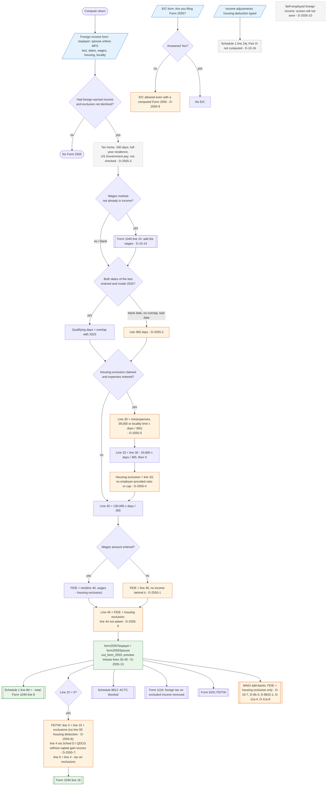

# Form 2555 — flowchart (as the code does it)

IRS rules: `C:\us-tax\new_lines\forms\2555.md`. Code details and deviations: `C:\us-tax\new_knowledge\forms\2555.md`.

Per person (the spouse only on a joint return), the "Foreign income" form must say Yes and not decline the exclusion.
No qualification test is checked (D-2555-3). Qualifying days come from the test's dates clipped to 2025 — a blank
date (bona fide "Continues") or no overlap gives a full year (D-2555-2). With the housing exclusion claimed, expenses
are capped at $39,000 or the Notice 2025-16 locality limit, less the base $20,800, both prorated by days ÷ 365
(D-2555-5); the result is the housing exclusion, with no employer-provided ratio (D-2555-4). The FEIE is the prorated
$130,000, limited by wages less the housing exclusion — or the full limit when wages are blank (D-2555-1). There is
no line 44 (D-2555-6) and no Part IX (D-10-16). The sum goes to Schedule 1 line 8d; line 16 uses the Foreign Earned
Income Tax Worksheet without the capital gain excess step (D-2555-7, D-2555-8). Foreign pay with no W-2 is added to
line 1h first.

Main code: `computeForm2555Exclusions` (`TaxReturnComputeService.java:9305-9398`), `computeQualifyingDaysIn2025`
(`:9400-9436`), line 8d (`:32376-32388`), FEITW (`:12432-12520`).

Deviation ids in the chart: D-2555-1 (blank wages → full limit), D-2555-2 (blank / outside dates → 365 days),
D-2555-3 (tests not checked), D-2555-4 (no employer-provided ratio), D-2555-5 (daily amounts), D-2555-6 (no line 44),
D-2555-7 (no capital gain excess), D-2555-8 (FEITW line 2a / 2c), D-2555-9 (EIC self-attested), D-2555-10 (self-employed
blocked), D-2555-13 (preview), and the referenced D-1h-14, D-10-16, D-10-7, D-6b-3, D-8815-1, D-11a-4, D-11a-8.
D-2555-11 (Part IV items), D-2555-12 (help text) and D-2555-14 (shared household) are not in the chart. No Form
2555-specific flag exists.
