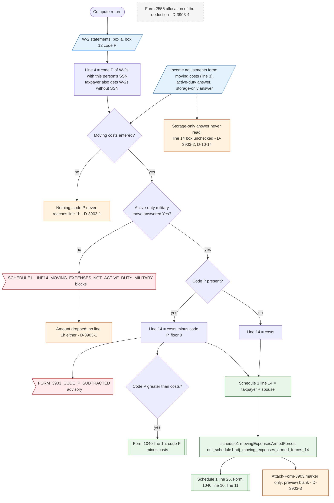

# Form 3903 — flowchart (as the code does it)

IRS rules: `C:\us-tax\new_lines\forms\3903.md`. Code details and deviations: `C:\us-tax\new_knowledge\forms\3903.md`.

For each person (taxpayer; spouse unless married filing separately) the compute first sums W-2 box 12 code P from the
W-2s with that person's SSN (the taxpayer also gets W-2s with no SSN) — Form 3903 line 4. The typed moving costs are
line 3. With no costs nothing happens — code P alone is never income (D-3903-1). With costs but no "active-duty
military move" Yes, the amount is dropped and the return is blocked. With Yes, Schedule 1 line 14 gets costs − code P
(not below zero, advisory when code P was subtracted), and if code P is larger the excess goes to Form 1040 line 1h.
The storage-fees-only answer is never read (D-3903-2; the line 14 box is D-10-14), Form 2555 allocation is not
modelled (D-3903-4), and only an "attach Form 3903" marker is produced (D-3903-3).

Main code: `withForm3903CodeP` (`TaxReturnComputeService.java:10367`), `gatedMovingExpense`
(`TaxReturnComputeService.java:10410`), `form3903ExcessPayments` (`TaxReturnComputeService.java:10392`).

Deviation ids in the chart: D-3903-1 (code P without costs or without the Yes answer is not income), D-3903-2
(storage-fees-only path not modelled; box: D-10-14), D-3903-3 (form not produced), D-3903-4 (Form 2555 allocation).
