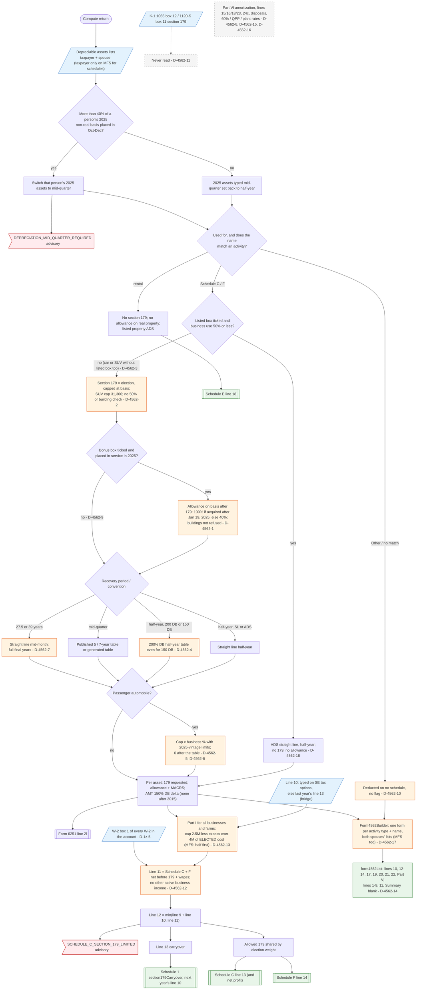

# Form 4562 — flowchart (as the code does it)

IRS rules: `C:\us-tax\new_lines\forms\4562.md`. Code details and deviations: `C:\us-tax\new_knowledge\forms\4562.md`.

The compute reads the "Depreciable assets (Form 4562)" lists of the taxpayer and the spouse (only the filer's on a
married-filing-separately return, for the schedules). Before anything else the mid-quarter 40% test runs per person
and switches 2025 assets to mid-quarter (or back to half-year). Each asset is matched by its "Used for" type and name
to a Schedule C business, a Schedule F farm or a rental property; an "Other" or unmatched asset reaches no schedule
(D-4562-10). Business and farm assets go through one routine: section 179 (capped at basis and the SUV cap, refused
only for listed property at 50% or less — D-4562-2, D-4562-3), the special allowance if ticked (100% / 40%, but not
refused for buildings — D-4562-1, D-4562-9), then MACRS (the half-year path uses the 200% DB table even for a 150% DB
election — D-4562-4; real property gets a full final year — D-4562-7), and the §280F car cap (2025 vintage only —
D-4562-5, D-4562-6). Rental assets get no section 179 and no allowance on real property. The §179 requests of all
businesses and farms meet one Part I limit (dollar cap and phase-out — D-4562-13; business income = Schedule C/F net
plus W-2 wages — D-4562-12, D-1z-5); the allowed amount is shared out and the rest carries to next year. Finally
`Form4562Builder` prints one form per activity (including the other spouse's on MFS — D-4562-17), with presentation
gaps (D-4562-14).

Main code: `assetDepreciationSection179AndBonus` (`TaxReturnComputeService.java:28111`), `computeMacrsDepreciation`
(`:28501`), Part I in `computeScheduleC` (`:27076-27128`), `Form4562Builder.build` (`Form4562Builder.java:61`).

Deviation ids in the chart: D-4562-1 (allowance on buildings), D-4562-2 (section 179 eligibility not checked),
D-4562-3 (car / SUV not treated as listed), D-4562-4 (150% DB uses the 200% DB table), D-4562-5 (car caps of
earlier vintages), D-4562-6 (unrecovered car basis), D-4562-7 (real-property final year), D-4562-8 (disposals),
D-4562-9 (allowance opt-in per asset), D-4562-10 (asset reaching no schedule), D-4562-11 (K-1 section 179),
D-4562-12 (line 11 income), D-4562-13 (phase-out and MFS split), D-4562-14 (form presentation), D-4562-15 (Part VI),
D-4562-16 (other lines and rates), D-4562-17 (other spouse's form on MFS), D-4562-18 (listed property convention);
D-1z-5 (W-2 wages on line 11).
