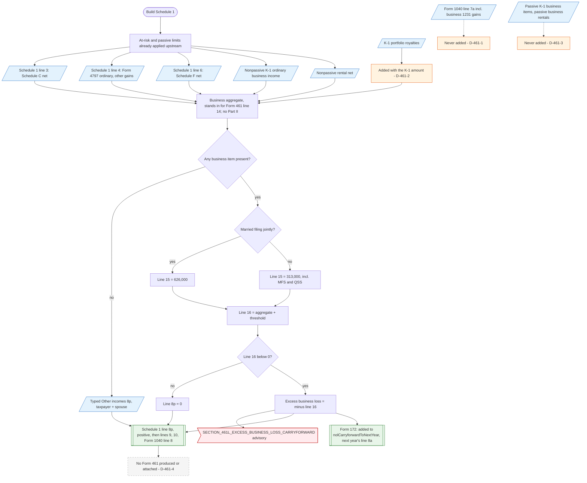

# Form 461 — flowchart (as the code does it)

IRS rules: `C:\us-tax\new_lines\forms\461.md`. Code details and deviations: `C:\us-tax\new_knowledge\forms\461.md`.

There is no Form 461 output (D-461-4); the limit is figured inside the Schedule 1 build. After the at-risk and passive
engines have run, the app adds Schedule 1 line 3 (Schedule C), line 4 (Form 4797 and other gains), line 6
(Schedule F), the nonpassive K-1 ordinary business income — which, through a shared parameter, also carries K-1
portfolio royalties (D-461-2) — and the nonpassive rental net. Capital gains on line 7a, including business section
1231 gains, never enter (D-461-1); passive trade-or-business activities never enter (D-461-3). The threshold ($626,000
for married filing jointly, $313,000 otherwise) is added; a negative result becomes Schedule 1 line 8p (positive), an
advisory, and part of next year's NOL on Form 172. With no business data at all, a typed 8p is used.

Main code: `TaxReturnComputeService.java:32285-32313` (limit), `:32479-32484` (line 8p), `:43683-43688` (threshold),
`:7398-7498` (hand-off to Form 172).

Deviation ids in the chart: D-461-1 (business capital gains left out), D-461-2 (K-1 portfolio royalties counted as
business), D-461-3 (passive trade-or-business activities left out), D-461-4 (Form 461 not produced).
