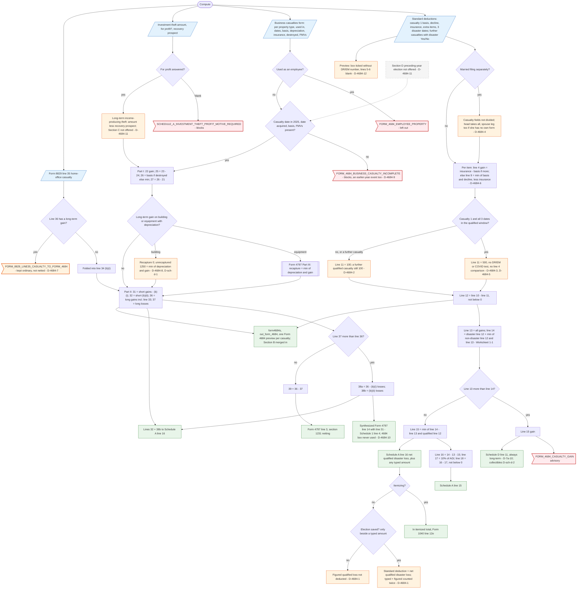

# Form 4684 — flowchart (as the code does it)

IRS rules: `C:\us-tax\new_lines\forms\4684.md`. Code details and deviations: `C:\us-tax\new_knowledge\forms\4684.md`.
Next steps: Schedule A (lines 15 / 16), `C:\us-tax\new_flowcharts\forms\schedule-d.md` (line 11) and the Form 4797 chart.

**Section A** comes from the casualty details on the Standard deductions form: casualty 1 (always a federally declared
disaster, any number of items) and further casualties (one property each, disaster Yes / No). Per casualty, line 9 =
min(basis, decline) − insurance per item, line 11 = $500 only for casualty 1 when its three dates fall in the
qualified-disaster window (D-4684-2, D-4684-3, D-4684-5), else $100. Lines 13–18 follow the form and Worksheet 1-1
(`Form4684SectionA.figure`). A net gain goes to Schedule D line 11, always long-term (D-7a-10). Without a gain,
`buildScheduleA` gives the same line 18 → Schedule A line 15 and the qualified loss → Schedule A line 16; a non-itemizer
adds it to the standard deduction only through an election saved beside a typed amount (D-4684-1). MFS does not divide
the casualty (D-4684-4).

**Section B** comes from the Business casualties and thefts form (taxpayer / spouse), the investment theft question and
Form 8829 line 35: Part I per property, Part II lines 29–39 (`Form4684SectionB`), routed to Form 4797 lines 3 / 14 /
Part III and Schedule A line 16. Sections C and D are not supported (D-4684-11). The typed Form 4684 statement is
dormant (`Form4684Mapper.formIds()` is empty).

Main code: `Form4684SectionA.java:85-232`, `Form4684SectionB.java:143-321`, `TaxReturnComputeService.java:16552-16670`
(Schedule A), `:53247-53257` (qualified test), `:3152-3154`, `:3235-3237`, `:4203-4226`, `:7717-7719` (wiring).

Deviation ids in the chart: D-4684-1 (qualified loss and the increased standard deduction), D-4684-2 (only casualty 1
qualified), D-4684-3 (no major-disaster / COVID test), D-4684-4 (MFS not divided), D-4684-5 (line 10 vs line 4
comparison), D-4684-6 (unclaimed / later reimbursement), D-4684-7 (home-office casualty not netted), D-4684-8 (section
1250 additional depreciation), D-4684-9 (earlier-year event blocked), D-4684-10 (Schedule 1 "4684" box), D-4684-11
(Sections C and D), D-4684-12 (printed form); referenced: D-7a-10 (line 15 always long-term), D-sch-d-1 (§1250 cap),
D-sch-d-2 (collectibles).
