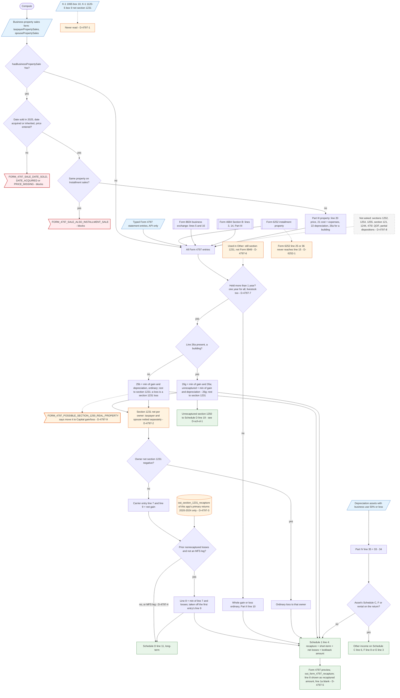

# Form 4797 — flowchart (as the code does it)

IRS rules: `C:\us-tax\new_lines\forms\4797.md`. Code details and deviations: `C:\us-tax\new_knowledge\forms\4797.md`.
Inputs from other forms: `6252.md`, `8824.md`, `4684.md`; next steps: `schedule-d.md` (lines 11 / 19).

Every source becomes a "Form 4797 entry": typed statement entries (API only), installment-sale property, each sale on
the Business property sales form (blocking checks: date sold, date acquired, price, same property on Installment
sales), business like-kind exchanges, business casualties and derived Part IV recaptures. One loop
(`computeForm4797Part3Recapture`) figures each property: held a year or less → ordinary; a building (line 26a typed or
0) → section 1250 ordinary + unrecaptured section 1250 + section 1231 residual; otherwise section 1245 recapture +
section 1231 residual; a loss → section 1231 loss. Section 1231 results are netted **per spouse** (D-4797-2); a net loss
is ordinary, a net gain goes to Schedule D line 11 after the 5-year lookback, which reads only this app's stored years
(D-4797-3) and is skipped on MFS legs (D-4797-4). K-1 section 1231 amounts never enter (D-4797-1). Ordinary amounts go
to Schedule 1 line 4; Part IV goes back to its Schedule C / F / E.

Main code: `TaxReturnComputeService.java:3141-3234` (assembly, Schedule 1 line 4, lookback), `:2029-2290` (Part III
loop), `:1814-1827` (per-owner netting), `:1689-1752` (lookback), `Form4797SalesCompute.java:42-120` (intake),
`Form4797Fields.java:35-176` (preview).

Deviation ids in the chart: D-4797-1 (K-1 section 1231 dropped), D-4797-2 (per-spouse netting), D-4797-3 (lookback
history only from this app), D-4797-4 (no lookback on MFS legs), D-4797-5 (preview lines 1a / 8), D-4797-6 ("Other"
use), D-4797-7 (livestock holding periods), D-4797-8 (unsupported cases), D-4797-9 (misdirecting advisory and hint);
from other forms: D-6252-1 (line 15), D-sch-d-1 (§1250 worksheet cap).
