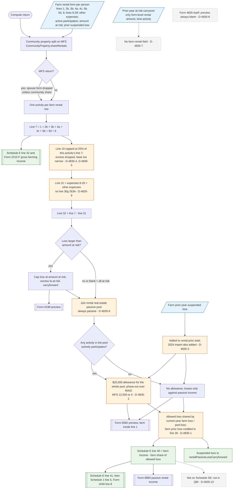

# Form 4835 — flowchart (as the code does it)

IRS rules: `C:\us-tax\new_lines\forms\4835.md`. Code details and deviations: `C:\us-tax\new_knowledge\forms\4835.md`.

Each farm rental on the "Farm rental (Form 4835)" form (taxpayer and spouse; on MFS the spouse's only through a
community-property share) becomes one activity. The app adds the taxable Part I amounts (line 7), subtracts the Part II
expenses with conservation expenses capped at 25% of that activity's line 7 — the excess is dropped (D-4835-4, D-4835-5;
no line 30g, D-4835-9) — and gets line 32. A loss is capped at the amount at risk (box 34b). The activity then joins the
rental real estate pool of the §469 engine: the $25,000 allowance applies to the whole pool when any activity has
active participation (D-4835-2), the farm's prior-year suspended loss is added to the rental prior total, on top of the
imported 2024 total (D-4835-3), and the allowed loss is split back by current-year loss only, so a released farm prior
loss lands on Schedule E line 26 (D-4835-1). The farm part goes to Schedule E line 40, line 41 and Schedule 1 line 5;
line 7 goes to Schedule E line 42. Form 4835 itself is never produced (D-4835-6).

Main code: `collectForm4835Activities` (`TaxReturnComputeService.java:31302`) and the farm loop of
`computeRentalScheduleE` (`TaxReturnComputeService.java:31050-31167`).

Deviation ids in the chart: D-4835-1 (farm prior loss on line 26), D-4835-2 (allowance to a non-active farm rental),
D-4835-3 (prior loss counted twice), D-4835-4 (conservation excess not carried), D-4835-5 (25% base), D-4835-6 (no
Form 4835 output), D-4835-7 (no prior at-risk field), D-4835-8 (real estate professional), D-4835-9 (no line 30g),
D-4835-10 (QBI).
