# Form 4972 — flowchart (as the code does it)

IRS rules: `C:\us-tax\new_lines\forms\4972.md`. Code details and deviations: `C:\us-tax\new_knowledge\forms\4972.md`.

Form 4972 runs per person after line 15 is final. With the election on, the Part I answers are checked (Q3 **or**
Q4 is enough, no birth date is compared — D-4972-1). The picked Form 1099-R (from the whole household list, else the
saved copy) gives boxes 1, 2a, 3 and 6; a typed recipient percentage **multiplies** box 2a and box 3 (D-4972-2). Part II
taxes box 3 at 20% (no NUA / death-benefit / estate-tax adjustments, D-4972-3 … D-4972-5). Part III builds lines 8–29
with the minimum distribution allowance and the 1986 schedule (line 24 rounded to dollars, line 18 not asked). Line
30 goes to Form 1040 line 16 box 2. Then the distribution is taken back out of lines 5a / 5b and the same amount out
of line 9, AGI and line 15, floored at 0 (D-5a-4, D-5b-11, D-9-2); on an MFS return the spouse's form is used here
too (D-4972-7).

Main code: `computeForm4972` (`TaxReturnComputeService.java:13346-13577`), `adjustPensionLinesForForm4972`
(`:52022-52082`), cascade (`:6059-6094`), line 16 box 2 (`:11805-11814`).

```mermaid
flowchart TD
    S([Compute return - line 15 already final]) --> IN[/"Lump-sum distributions form<br/>taxpayer; spouse"/]:::input
    IN --> EL{"Elects Form 4972?"}
    EL -->|no| NONE([No Form 4972 - lump sum stays on 5a / 5b])
    EL -->|yes| P1{"Q1 entire balance, Q2 no rollover,<br/>Q5 / Q6 no prior use?"}
    P1 -->|no| INEL>FORM4972_*_INELIGIBLE advisory, no form]:::flag
    P1 -->|yes| Q34{"Q3 born before 1936 / beneficiary<br/>OR Q4 five years OR QDRO?"}
    Q34 -->|"no"| INEL
    Q34 -->|"yes - either one is enough, no DOB check - D-4972-1"| SRC[/"Picked 1099-R from the household list,<br/>else saved copy: box 1, 2a, 3, 6; typed box 8"/]:::input
    SRC --> MR{"Recipient % below 100?"}
    MR -->|yes| MRX["Multiply box 2a and box 3 by the %<br/>no MRD on line 29 - D-4972-2"]:::warn
    MR -->|no| B2A
    MRX --> B2A{"Box 2a positive?"}
    B2A -->|no| NOST>FORM4972_*_NO_STATEMENT advisory, no form - D-4972-8]:::flag
    B2A -->|yes| P2{"Part II and box 3 > 0?"}
    P2 -->|yes| L7["Line 6 = box 3; line 7 = 20%<br/>no NUA / death benefit / estate tax share - D-4972-3, D-4972-4"]:::warn
    P2 -->|no| P3
    L7 --> P3{"Part III?"}
    P3 -->|yes| L8["Line 8 = box 2a - box 3 if Part II, else box 2a;<br/>+ full box 6 if NUA elected"]
    L8 --> L12["Lines 9-12: minus typed death benefit, plus box 8"]
    L12 --> MDA["Lines 13-17: MDA = min(50%, 10,000) - 20% over 20,000"]
    MDA --> L19["Line 19 = line 17; estate tax line 18 not asked - D-4972-5"]:::oos
    L19 --> L25["Lines 23-25: 10 x 1986-schedule tax on 10%, line 24 rounded"]
    L25 --> ANN{"Box 8 annuity > 0?"}
    ANN -->|yes| L28["Lines 20-22, 26-28: annuity offset"]
    ANN -->|no| L29
    L28 --> L29["Line 29 = line 25 - line 28"]
    P3 -->|no| L30
    L29 --> L30["Line 30 = line 7 + line 29"]
    L30 --> OUT["form4972Taxpayer / form4972Spouse<br/>out_form_4972"]:::output
    OUT --> L16[["Form 1040 line 16 box 2: taxpayer + spouse<br/>spouse dropped on MFS"]]:::output
    L16 --> AMT[["Form 6251 line 10 subtracts it"]]
    OUT --> RM{"Part III used?"}
    RM -->|yes| RM3["Take box 1 off line 5a, box 2a off line 5b<br/>scaled box 2a - D-4972-2"]
    RM -->|"Part II only"| RM2["Take box 3 off 5a and 5b - D-5a-4"]:::warn
    RM3 --> MFS["Spouse form used even on MFS - D-4972-7"]:::warn
    RM2 --> MFS
    MFS --> CAS["Subtract the 5b reduction from line 9, AGI, line 15, floor 0 - D-9-2;<br/>AGI-based figures not redone - D-5b-11"]:::warn
    CAS --> L5[["Form 1040 lines 5a, 5b, 9, 11, 15"]]:::output
    MULTI["Second lump sum or second participant: no second Form 4972 - D-4972-6"]:::oos

    classDef input fill:#e3f2fd,stroke:#1565c0
    classDef flag fill:#ffebee,stroke:#c62828
    classDef output fill:#e8f5e9,stroke:#2e7d32
    classDef warn fill:#fff3e0,stroke:#e65100
    classDef oos fill:#f5f5f5,stroke:#9e9e9e,stroke-dasharray: 5 5
```

Deviation ids in the chart: D-4972-1 (Q3 or Q4, no birth date), D-4972-2 (multiple recipients scaled the wrong way),
D-4972-3 (NUA with Part II), D-4972-4 (death benefit), D-4972-5 (estate tax), D-4972-6 (one form per person),
D-4972-7 (spouse form on MFS removal), D-4972-8 (blank box 2a), and the referenced D-5a-4, D-5b-11, D-9-2.
D-4972-9 (help text) is not in the chart.
