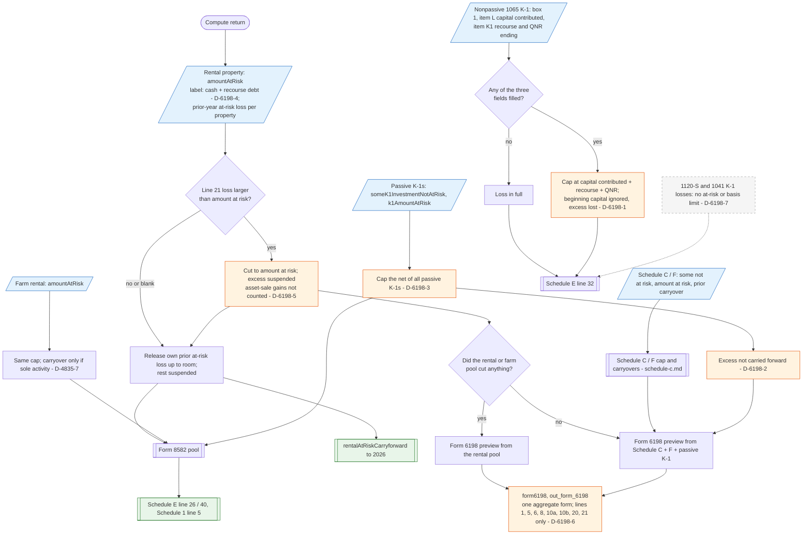

# Form 6198 — flowchart (as the code does it)

IRS rules: `C:\us-tax\new_lines\forms\6198.md`. Code details and deviations: `C:\us-tax\new_knowledge\forms\6198.md`.

The app has no Form 6198 worksheet: each at-risk activity carries one typed (or K-1-derived) amount at risk, and a loss
larger than it is cut to it before the passive-loss rules. Rental properties release their own prior-year at-risk loss
and carry the rest (one Schedule 1 total); the rental field's label leaves out qualified nonrecourse financing
(D-6198-4); asset-sale gains of the activity do not raise the room (D-6198-5). Farm rentals follow the same cap
(carryover: D-4835-7). Schedule C / F businesses have their own cap and carryovers (`forms\schedule-c.md`). Passive K-1s
are capped as **one net** (D-6198-3) and their excess is never carried (D-6198-2). A nonpassive partnership loss is capped
at capital contributed this year + recourse + QNR and the excess vanishes (D-6198-1); S corporation and trust losses are
not limited (D-6198-7). One aggregate preview is built only when a cap bound (D-6198-6).

Main code: rental `TaxReturnComputeService.java:30897-30937`, farm rental `:31050-31099`, passive K-1 `:3858-3871`,
partnership `:31534-31544`, preview `:31264-31280` and `:7605-7623`.

Deviation ids in the chart: D-6198-1 (partnership amount at risk and lost excess), D-6198-2 (passive K-1 excess not
carried), D-6198-3 (one cap on the K-1 net), D-6198-4 (rental label omits QNR), D-6198-5 (asset-sale gains), D-6198-6
(preview), D-6198-7 (S corporation and trust losses); D-4835-7 (farm-rental carryover, in `forms\4835.md`).
