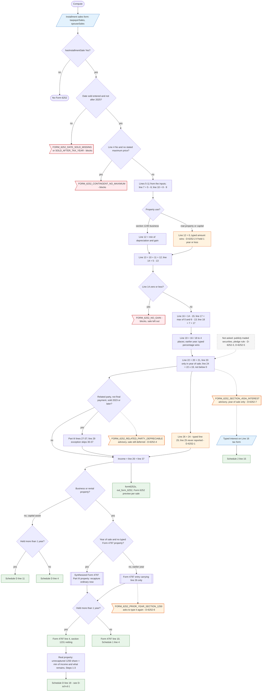

# Form 6252 — flowchart (as the code does it)

IRS rules: `C:\us-tax\new_lines\forms\6252.md`. Code details and deviations: `C:\us-tax\new_knowledge\forms\6252.md`.
Next steps: `C:\us-tax\new_flowcharts\forms\schedule-d.md` (lines 4 / 11 / 19) and the Form 4797 chart.

Each sale on the Installment sales form (taxpayer / spouse) is figured by `Form6252Compute.figure`. A missing or
post-2025 date sold, a contingent sale with no stated maximum, or no gain (line 14 ≤ 0) blocks the return and leaves
the sale out. Line 12 is figured only for §1245 business property (real property held a year or less gets 0 —
D-6252-2); line 19 = line 16 ÷ line 18 to 4 places (an earlier year's typed percentage wins); line 24 = line 22 ×
line 19; a typed line 25 is subtracted but never reported (D-6252-1). Part III runs for a related party within two years
until the final payment. Line 26 + line 37 then go to Schedule D line 4 / 11 for a capital asset, or through a Form 4797
entry (Part III in the year of sale, line 4 / 10 later) for business property, with the unrecaptured §1250 share as
received. Publicly traded securities and the pledge rule are not asked (D-6252-3, D-6252-5); §453(g) and §453A are
advisories only (D-6252-4, D-6252-7); the earlier-year §1250 advisory invites a double count (D-6252-6).

Main code: `Form6252Compute.sales` / `figure` (`Form6252Compute.java:54-267`), Form 4797 link
(`TaxReturnComputeService.java:2103-2160`, `:2211-2225`), Schedule D routing (`:25314-25333`), output (`:7715`).

Deviation ids in the chart: D-6252-1 (line 25 / 36 dropped), D-6252-2 (line 12 of short-held real property),
D-6252-3 (publicly traded securities), D-6252-4 (§453(g) advisory only), D-6252-5 (pledge rule), D-6252-6
(earlier-year §1250 advisory), D-6252-7 (§453A advisory scope); from Schedule D: D-sch-d-1 (§1250 worksheet cap).
