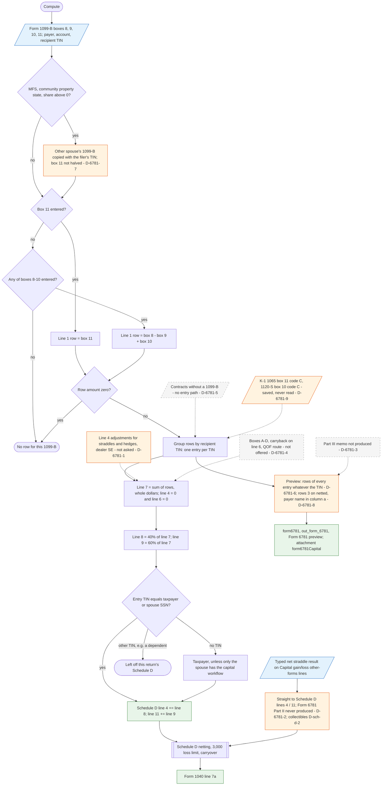

# Form 6781 — flowchart (as the code does it)

IRS rules: `C:\us-tax\new_lines\forms\6781.md`. Code details and deviations: `C:\us-tax\new_knowledge\forms\6781.md`.
Next steps: `C:\us-tax\new_flowcharts\forms\schedule-d.md` (lines 4 / 11).

Only Form 1099-B boxes 8–11 feed Form 6781. For each 1099-B, box 11 (or box 8 − box 9 + box 10 when box 11 is blank)
becomes a line 1 row; rows are grouped by recipient TIN; each person's line 7 is split 40% → Schedule D line 4 and
60% → Schedule D line 11, taking only entries whose TIN is the taxpayer's or spouse's (`Form6781Compute.withForm1099B`,
`TaxReturnComputeService.java:25291-25307`). Line 4 and line 6 are always 0 (D-6781-1, D-6781-4); Part II straddles can
only be typed as a net on the Capital gain/loss form, straight to Schedule D (D-6781-2); Part III is not produced
(D-6781-3); contracts without a 1099-B (D-6781-5) and a K-1's section 1256 amount (D-6781-9) have no route. On a
community-property separate return box 11 is not halved (D-6781-7). The preview puts every TIN's rows on one form
(D-6781-6) with wording differences (D-6781-8). The typed Form 6781 statement is dormant (`Form6781Mapper.formIds()`
is empty).

Main code: `Form6781Compute.java:35-123`, wiring `TaxReturnComputeService.java:3238-3240`, `:7716`, community split
`CommunityProperty.java:58-97`.

Deviation ids in the chart: D-6781-1 (line 4 adjustments, hedges, dealer SE), D-6781-2 (Part II only typed),
D-6781-3 (Part III), D-6781-4 (elections and carryback), D-6781-5 (contracts without a 1099-B), D-6781-6 (preview takes
every TIN), D-6781-7 (community property box 11 not halved), D-6781-8 (printed-form wording), D-6781-9 (K-1 section 1256
amount not read); from Schedule D: D-sch-d-2 (collectibles).
