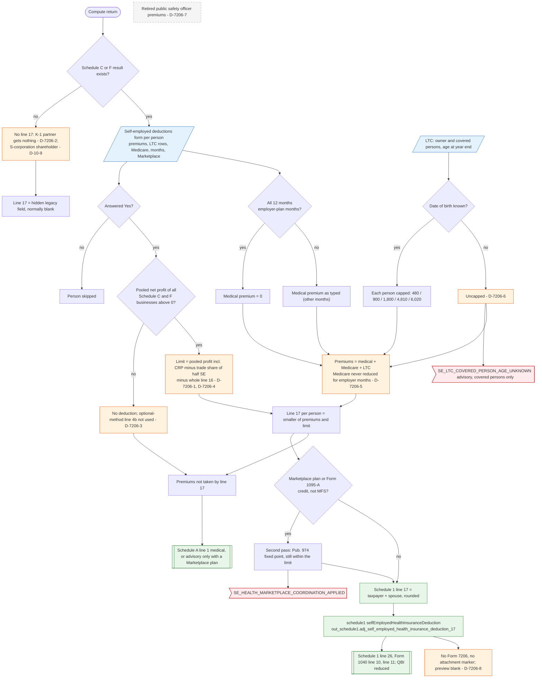

# Form 7206 — flowchart (as the code does it)

IRS rules: `C:\us-tax\new_lines\forms\7206.md`. Code details and deviations: `C:\us-tax\new_knowledge\forms\7206.md`.

The compute runs `computeSeDeductions` after Schedule C, Schedule F and Schedule SE. Nothing happens without a
Schedule C / F result — so a partner with only a K-1 gets no deduction (D-7206-2) and an S-corporation shareholder has
no path (D-10-9). For each person who answered Yes and has a positive pooled net profit (all businesses, losses
netted, CRP included — D-7206-1, D-7206-4; net profit even under an optional method — D-7206-3), the limit is that
profit less the trades' share of ½ SE and less the whole line 16 (D-7206-1). Premiums = medical (0 only when all 12
months are employer-plan months) + Medicare (never reduced — D-7206-5) + LTC capped by each person's age (uncapped if
the date of birth is missing — D-7206-6); no retired-public-safety input (D-7206-7). Line 17 = the smaller amount, or,
for a Marketplace plan, the Pub. 974 fixed point found on a second compute pass. Premiums left over go to Schedule A.
No Form 7206 is produced (D-7206-8).

Main code: `computeSeDeductions` (`TaxReturnComputeService.java:29722`), `solvePub974SeHealthPtc`
(`TaxReturnComputeService.java:29875`), Schedule 1 line 17 (`TaxReturnComputeService.java:32881`).

Deviation ids in the chart: D-7206-1 (pooled limit, not per business), D-7206-2 (K-1 partner), D-7206-3 (optional
method), D-7206-4 (CRP in the limit), D-7206-5 (employer-plan months: Medicare and dependents' employers), D-7206-6 (LTC
uncapped without a date of birth), D-7206-7 (retired public safety officer), D-7206-8 (form not produced); D-10-9
(S-corporation shareholder, recorded under line 10).
