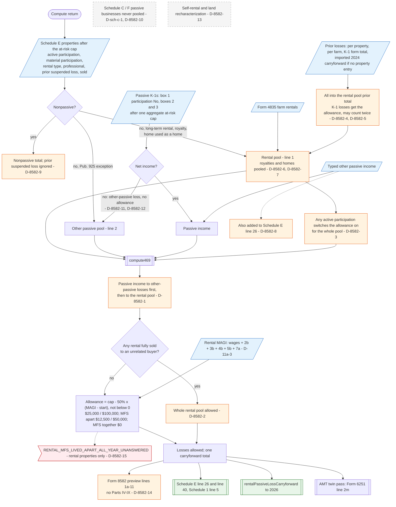

# Form 8582 — flowchart (as the code does it)

IRS rules: `C:\us-tax\new_lines\forms\8582.md`. Code details and deviations: `C:\us-tax\new_knowledge\forms\8582.md`.

The app limits passive losses on the **aggregate**, inside `computeRentalScheduleE`. Every Schedule E property, after
its at-risk cap, is either nonpassive (its prior-year suspended loss is then ignored, D-8582-9), an "other passive"
exception rental (line 2), or part of the rental pool (line 1) — the pool also takes royalties and homes used as a home
(D-8582-6, D-8582-7) and Form 4835 farm rentals. One active-participation answer anywhere switches the allowance on for
the whole pool (D-8582-3). Passive K-1s (box 1 with material participation No, and boxes 2 / 3 — never allowance-eligible,
D-8582-12; PTPs not separated, D-8582-11) give other-passive income or loss; the typed other passive income is added both
here and to Schedule E line 26 (D-8582-8). Prior-year losses: per property and farm entries, the K-1 form's total, and
last year's imported total all land in the rental pool (D-8582-4) and the K-1 one can be counted twice (D-8582-5).
`compute469` then spends passive income on other-passive losses first (D-8582-1), applies the $25,000 allowance
(phase-out on a partial MAGI — D-11a-3; MFS $12,500 / $0, D-8582-15 for the prompt), or releases the whole pool when any
one rental is sold (D-8582-2). Lines 1a–11 are printed; Parts IV–IX are not (D-8582-14). Schedule C / F passive
businesses never enter (D-sch-c-1, D-8582-10).

Main code: `computeRentalScheduleE` (`TaxReturnComputeService.java:30490-31256`) and `compute469`
(`TaxReturnComputeService.java:30436-30459`).

Deviation ids in the chart: D-8582-1 (income ordering), D-8582-2 (one sale frees the pool), D-8582-3 (one
active-participation switch), D-8582-4 / -5 (K-1 prior losses), D-8582-6 (royalties), D-8582-7 (home used as a home),
D-8582-8 (typed other passive income), D-8582-9 (former passive activity), D-8582-10 (Schedule F), D-8582-11 (PTP),
D-8582-12 (K-1 box 2), D-8582-13 (recharacterization), D-8582-14 (Parts IV–IX), D-8582-15 (MFS prompt); MAGI D-11a-3.
