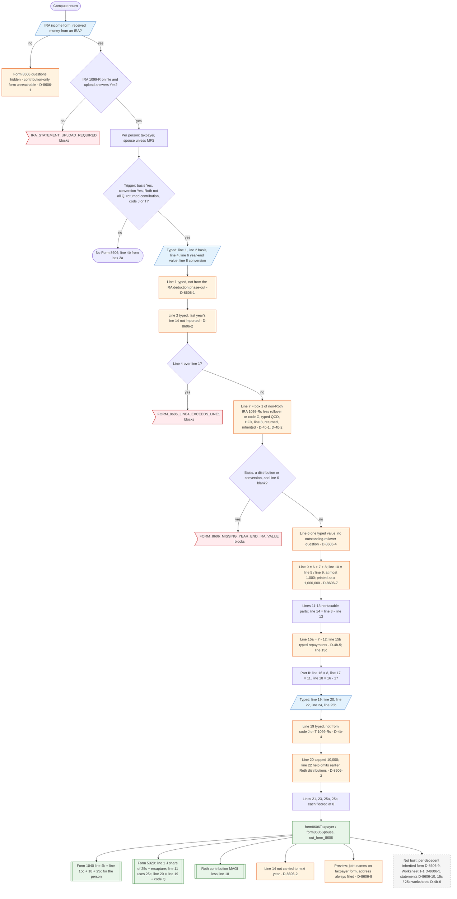

# Form 8606 — flowchart (as the code does it)

IRS rules: `C:\us-tax\new_lines\forms\8606.md`. Code details and deviations: `C:\us-tax\new_knowledge\forms\8606.md`.
The line 4a / 4b side is in `C:\us-tax\new_flowcharts\4b.md`.

Everything comes from the person's "IRA income" form and their IRA Forms 1099-R. The Form 8606 questions only appear
after "Did you receive money from an IRA this year?" = Yes, and Yes without an IRA 1099-R blocks — so a
contribution-only Form 8606 cannot be reached (D-8606-1). One of five triggers builds the form per person (spouse
suppressed on MFS). Line 1 and line 2 are typed every year — no link to the IRA deduction phase-out and no carryover of
last year's line 14 (D-8606-1, D-8606-2). Line 7 is box 1 of the non-Roth IRA 1099-Rs less the typed exclusions
(D-4b-1, D-4b-2); line 6 is one typed value (D-8606-4); the ratio is capped at 1.000. Part III starts from a typed line
19 (D-4b-4) and typed bases (D-8606-3). Lines 15c + 18 + 25c replace the person's line 4b figure; line 14 is stored but
not carried to the next year.

Main code: `buildForm8606` (`TaxReturnComputeService.java:21344-21450`), trigger `:21043-21047`, flags `:20496-20557`.

Deviation ids in the chart: D-8606-1 (contribution-only form unreachable; line 1 not linked to the deduction
phase-out), D-8606-2 (no basis carryover), D-8606-3 (line 22 help), D-8606-4 (line 6 outstanding rollovers),
D-8606-5 (no Worksheet 1-1), D-8606-7 (line 10 print), D-8606-8 (header / address), D-8606-9 (inherited per-decedent
form), D-8606-10 (statements); from line 4b: D-4b-1, D-4b-2, D-4b-4, D-4b-5, D-4b-6. D-8606-6 (lines 6, 9, 10 filled on
the "No" branch; form built from the basis question alone) is cosmetic and not drawn.
