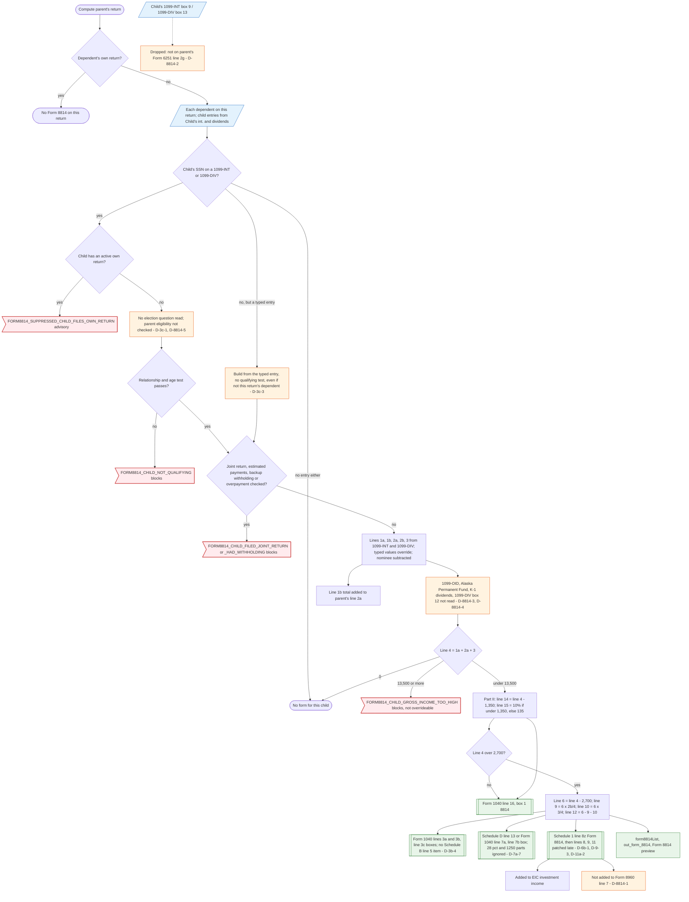

# Form 8814 — flowchart (as the code does it)

IRS rules: `C:\us-tax\new_lines\forms\8814.md`. Code details and deviations: `C:\us-tax\new_knowledge\forms\8814.md`.

For every dependent on the return whose SSN is the recipient on a Form 1099-INT or 1099-DIV, the compute builds a
Form 8814 without asking for the election (D-3c-1), unless the child files his or her own return. The relationship /
age test and four hand checkboxes can block it; other IRS conditions and the "which parent" rule are not checked
(D-3c-2, D-3c-3, D-8814-5). Lines 1a–3 come from 1099-INT and 1099-DIV only (no 1099-OID, Alaska Permanent Fund or
K-1 dividends, no exempt-interest dividends — D-8814-3, D-8814-4), a typed child entry overrides them, nominee amounts
are subtracted. Line 4 at or over $13,500 blocks the return. Above $2,700 the excess is split into line 9
(lines 3a / 3b), line 10 (Schedule D line 13 or line 7a) and line 12 (Schedule 1 line 8z); line 15 (10%, at most
$135) goes to line 16 box 1. Line 12 never reaches Form 8960 (D-8814-1); the child's private activity bond interest
never reaches Form 6251 (D-8814-2).

Main code: `computeChildInterestDividends` and `buildForm8814` (`TaxReturnComputeService.java:24341-24712`),
routing at `:3641-3698`, `:5095`, `:11792-11925`, `:19765-19769`.

Deviation ids in the chart: D-3c-1 (no election), D-3c-3 (hand entry on both MFS legs), D-8814-5 (which parent may
elect), D-8814-3 (1099-OID / APF / K-1 dividends), D-8814-4 (exempt-interest dividends), D-3b-4 (Schedule B line 5),
D-7a-7 (28% / §1250 parts), D-6b-1 / D-9-3 / D-11a-2 (line 12 added late), D-8814-1 (Form 8960), D-8814-2 (Form 6251).
