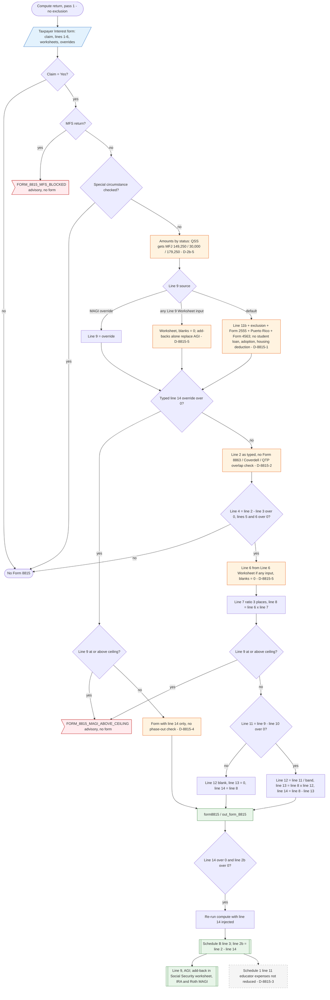

# Form 8815 — flowchart (as the code does it)

IRS rules: `C:\us-tax\new_lines\forms\8815.md`. Code details and deviations: `C:\us-tax\new_knowledge\forms\8815.md`.

Everything comes from the taxpayer's Interest form. No claim, an MFS return (advisory), a self-certified
"special circumstance", line 4 of zero or missing expenses / proceeds / interest stop the form. A typed line 14
("override") is used as is once it clears the MAGI ceiling, giving a form with only line 14 (D-8815-4). Otherwise
lines 2-8 are figured (line 6 from the Line 6 Worksheet if any of its inputs is filled, blanks = 0, D-8815-5); line 9
is the MAGI override, else the Line 9 Worksheet if any of its inputs is filled (blanks = 0, D-8815-5), else line 11b
plus the Form 2555 / Puerto Rico / Form 4563 add-backs (no student-loan, adoption or housing-deduction add-back,
D-8815-1). Qualifying surviving spouse uses the joint amounts (D-2b-5). At or above the ceiling there is no form; in
the band the exclusion is reduced; line 14 is then subtracted from line 2b on a second compute pass.

Main code: `computeForm8815` (`TaxReturnComputeService.java:8911-9110`), `resolveForm8815Line9` (`:8872-8893`),
second pass (`:7511-7529`).

Deviation ids in the chart: D-2b-5 (QSS gets joint-return amounts), D-8815-1 (default MAGI add-backs incomplete),
D-8815-2 (no education-credit / Coverdell / QTP overlap check), D-8815-3 (educator expenses not reduced), D-8815-4
(override form has only line 14), D-8815-5 (partly filled worksheets: blanks = 0).
